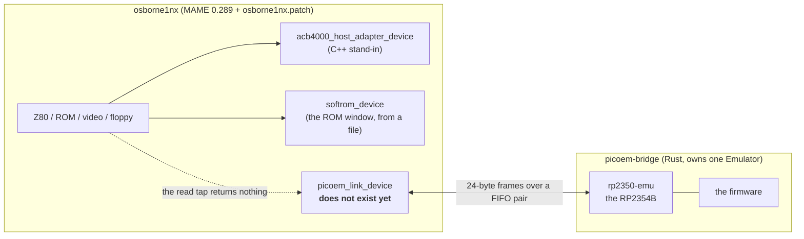

# The emulation testbed — MAME, picoem, and the RP2354B firmware (#192)

**Status: the loop exists and does not close.** A real RP2354B firmware binary
runs in `picoem`; `osborne1nx`'s I/O cycles reach its pins; its answer comes back
into the MAME **log** — and not into the guest. This document is the single place
that says what the testbed is, what is missing from it, who owns each missing
piece, and what "done" means for each one.

It is also the **gap register** for both emulators. Two lists existed before this
document and neither was complete: `docs/picoem-bridge.md` §5 has the picoem
gaps, `docs/mame-emulation.md` §7 has MAME's open items, and several of the
statements in both are stale relative to the code. §4 is the one list.

**The child documents, and the relationship.** This document owns the *loop*, the
gap register and the plan. It does not restate measurements that live elsewhere:

| Document | Owns |
|---|---|
| `docs/picoem-bridge.md` | the **wire** — the frame, the FIFO, the bus cycle, and the seven picoem gaps as they were found |
| `docs/osborne1nx-machine.md` | the **machine** — the widened I/O decode, the ACB-4000 host adapter, the `softrom` window |
| `docs/mame-emulation.md` | running the stock Osborne machines, and the disk/ROM matrix |
| `docs/image-library-design.md` | the library's layout and media decision (#283, #285) |
| `docs/rom-pico-protocol.md` | the ROM↔Pico door, and the two doors' addresses |
| **this document** | **the loop, the gap register, the plan, and what cannot be emulated at all** |

Where this document corrects one of them, the correction is marked, and the child
document keeps its own measurement.

## 1. What the testbed is

Two emulators model two halves of one board, and one wire joins them:



The wire is built and it passes: `tools/emulator-setup/mame-osborne1nx/picoem-check.sh`
reports **7 PASS / 0 FAIL**, driving `W30=A5, R30, W31=5A, R31` and getting the
firmware's bytes back with a heartbeat edge count. `docs/picoem-bridge.md` is that
work, and §2 of it is the measurement that the channel is a **FIFO pair, not a
socket** (MAME's Lua preloads exactly four modules and `3rdparty/` has no
luasocket).

**What makes it a demonstration rather than a testbed** is one sentence from
`o1next-picoem.lua`'s own header: *the read tap does not return the firmware's
byte to the guest*. MAME's Lua read taps can, and a read tap that returns data
**segfaults once the guest polls in a tight loop** — measured on 0.289
(`tools/research/acb4000.lua`, GOTCHAS). So the answer is logged, and optionally
scribbled into a guest scratch byte, and the Z80's own `IN` still returns the
card device's byte. The loop is open on the side that matters.

## 2. The four things that are not real

"Fake" is the right word for some of this and not for the rest, and the
distinction decides the plan. In order of how real they are:

| | What | State |
|---|---|---|
| **Real** | The firmware's own contracts and logic — the image library, the mailbox engine, the media layer over FatFS | host-tested, in CI (#283, #285) |
| **Real** | The RP2354B's **bus** half in picoem — core, FPU, GPIO/CP0, SIO, PIO, XIP flash, clock tree, NVIC | it works; `osborne1nx`'s cycles reach the pins and the answer comes back |
| **Real but unclosed** | The wire | it carries the bytes; the guest cannot read them (§1) |
| **Not real** | The MAME-side stand-ins: `acb4000_host_adapter_device` is a C++ re-implementation of the ACB-4000, and `softrom_device` answers the ROM door out of a file | both are *good* — the card was read out of the driver and four handshake bugs were found against it — but they are not the firmware |
| **Not real, and named as such** | The storage **transports**. `#285` delivered FatFS, the seam and three real FAT volumes; the SPI flash, microSD and USB devices behind `blockdev.h` do not exist, in emulation or on a board | this is the "fake storage" of the last few sessions, and §4.3 decides what to do about it |

## 3. Four corrections to what the tree currently says

These are the most valuable output of the survey that produced this document,
because three of them are places where a document or an issue is **stale relative
to the code**, and one of them changes the plan.

### 3.1 picoem's issue tracker has never had an issue filed

Measured: `github.com/0x4D44/picoem/issues` reads **0 open and 0 closed**, for all
time. Its `CONTRIBUTING.md` says, verbatim: *"I'm happy to look at issues and pull
requests, but I'm not making any commitments about response times, triage, or
whether things will get merged or fixed. If you need certainty around a fix or
feature, the safest path is to fork."*

**So "document the gap upstream" is not a strategy.** A filed issue would be read
by nobody. The community-useful artifact is a patch series this project owns —
and the repository already has exactly that pattern for exactly that reason:
`tools/emulator-setup/mame-osborne1nx/osborne1nx.patch` is a 1210-line patch to a
source tree we do not own. `tools/emulator-setup/picoem/` is the second one.

### 3.2 Upstream `main` **is** the commit we pin

Measured this pass: `git ls-remote origin HEAD` → `8e20a82…`, byte-identical to
the `rev` in `tools/picoem-bridge/Cargo.toml` (2026-06-27, four months old).

**The six switches in `firmware/picoem-smoke/CMakeLists.txt` cannot be waited
out.** `REQUIREMENTS.md`'s re-pin procedure has no candidate, so every gap in §4.2
has to be fixed, forked around, or documented as permanent.

### 3.3 "UART, SPI, I2C, DMA and timers are stubs" is stale — and the real gap is different

`#192`'s plan comment and `firmware/library/README.md` both say the storage path
*"can never be exercised in the emulator"* because those peripherals are stubs.
That came from picoem's README status table. **The code at the pinned commit says
otherwise**, and the difference matters because it moves the work:

| File | Lines | What is actually there |
|---|---|---|
| `peripherals/spi.rs` | **610** | a real PL022: TX/RX FIFOs, `SSPSR` TFE/TNF/RNE/RFF/BSY, baud-rate `tick()`, loopback (`LBM`), DMA DREQs, IRQ routing |
| `peripherals/uart.rs` | **1040** | FIFOs, `UARTIFLS` thresholds, DREQs, drain cadence, loopback |
| `dma.rs` | **2616** | channels, DREQ matrix, `needs_tick()`/`tick_dma`, IRQ routing — with *named* exclusions (BSWAP, two-tier priority, CRC sniff, DMA-to-DMA narrow) |
| `peripherals/timer.rs`, `i2c.rs`, `pwm.rs`, `adc.rs` | — | wired into `Bus` and **ticked** in `tick_peripherals()` |
| `peripherals/io_bank0.rs` | **331** | 48 pins, `GPIOn_CTRL`/`STATUS`, INTR/PROCE/PROCF groups — **plain storage** |

So the storage path is not blocked by a missing SPI. It is blocked by two things,
and the first is stated by picoem's own module doc:

> `GPIOn_CTRL` … plain-storage 32-bit word covering FUNCSEL, OUTOVER, OEOVER,
> INOVER, IRQOVER … **No active pin routing** — peripherals do not drive pin state
> through FUNCSEL in V5.

confirmed in `Emulator::update_gpio()`: the merged pin word is SIO + PIO +
external stimulus, and **`FUNCSEL` is never consulted**.

- **There is no pad mux.** A firmware that configures SPI and writes `SSPDR` gets
  a TX FIFO that drains into the void. This is *one layer*, and every transport
  needs it.
- **There is no device behind any peripheral.** Loopback is the only thing SPI can
  talk to: no microSD, no W25Q, no USB stick.
- **There is no USB controller model at all** on RP2350 — only clock-tree entries
  (`CLK_USB_CTRL/DIV/SELECTED`, `PLL_USB`). TinyUSB host MSC for the USB stick
  medium is the largest single piece in this document, and §4.3 argues it should
  never be built.

**And a fidelity gap worth recording on its own:** because `FUNCSEL` is not
enforced, PIO and SIO drive pins *regardless of the mux*. That is precisely why
the smoke firmware works, and it means **pin mis-configuration and pin conflicts
are invisible in emulation**. A personality that passes in picoem can still be
wrong on silicon because two functions share a pad. That is a known
**false-negative source**, not a bug.

### 3.4 The picoem gap list was seven rows and two fixes were missing from it

`docs/picoem-bridge.md` §5 lists seven gaps and then proposes a five-item patch
list, of which item 1 is *"re-derive `cp0_mcr_mrc_family`'s table from
`hardware/gpio_coproc.h`"*. That is **necessary and not sufficient**: the SDK's
`gpio_put()` and `gpio_set_dir()` are not MCR/MRC at all. They are **MCRR**:

```c
static inline void gpio_put(uint gpio, bool value)   { gpioc_bit_out_put(gpio, value); }
static inline void gpio_set_dir(uint gpio, bool out) { gpioc_bit_oe_put(gpio, out); }
/*   gpioc_bit_out_put -> mcrr p0, #4, gpio, value, c0
     gpioc_bit_oe_put  -> mcrr p0, #4, gpio, out,   c4  */
```

and picoem had **no CP0 MCRR dispatch at all**. So the two most-used GPIO calls in
any firmware were silent NOPs, and re-deriving the MCR/MRC table alone would have
left them that way. Both fixes are now in
`tools/emulator-setup/picoem/rp2350-coproc-and-exclusive.patch` — see §4.2 and
that directory's README.

## 4. The gap register

One row per gap: what the emulator does, what it costs, the measurement, the fix,
and who owns it. Sizes are **estimates**, and marked as such; everything else is
measured or read from a source.

### 4.1 MAME-side — ours, no upstream dependency

| # | Gap | Cost | Size (est.) | Blocked on |
|---|---|---|---|---|
| **M1** | **The guest cannot read the firmware's answer.** The Lua read tap returns nothing, because a data-returning Lua read tap segfaults once the guest polls tight (measured, 0.289) | the loop is a demonstration, not a testbed | **small** — a C++ device in the patch that owns the FIFO and returns `r.data` from `read()`; two existing devices are the template | nothing. **Can land now** |
| **M2** | **Memory cycles are refused.** The frame carries `addr` but v1 does not drive the address bus (`status` 2) | the ROM window and the Drive C mapping are memory-mapped, so #179 and the ROM door need this | medium | M3, and the personality that needs it |
| **M3** | **One byte per cycle.** `MODE SELECT`, the CDB and the data phase need a burst or a window | a real SCSI transfer cannot be modelled | small–medium — the frame's `addr` and `cycles` fields are the seam | M1 |
| **M4** | **No staged test machine.** `stage.sh` copies the binary, ROMs and launcher into one directory; the picoem-backed machine has no such stage | "boot the emulated interposer and play" is a hand-built command line | small | M1 |

### 4.2 picoem-side — a fork, because there is no tracker

| # | Gap | Cost | Size (est.) | State |
|---|---|---|---|---|
| **P1** | **CP0's MCR/MRC table is transposed, and MCRR is not decoded.** `gpio_set_dir` and every `set`/`clr`/`xor` were silent NOPs | the firmware runs and drives nothing | — | **FIXED** — `tools/emulator-setup/picoem/` |
| **P2** | **`LDAEX`/`STLEX` not decoded**, so an unhandled `LDAEXB` executed `LDRD {Rt, pc}` and the core loaded its PC out of the lock byte it was reading | any firmware that claims a hardware resource dies | — | **FIXED** — same series |
| **P3** | **Every UsageFault is reported as `UFSR.UNDEFINSTR`**, so a disabled coprocessor arrives looking like a bad opcode at a bootrom address | cost a full hour of the #286 session | **trivial** — report `NOCP` vs `UNDEFINSTR` | open |
| **P4** | **SIO is bank 0 only** — no `GPIO_HI_OUT`/`GPIO_HI_OE`, so GP32–47 can be neither driven nor observed | Rev B needs GP38/39 (the ESP32 UART) and GP47 (the debug LED) | small — `Bus` already has `gpio_external_mask_hi` and PIO already samples the high bank, so it is the SIO register file that is short | open |
| **P5** | **No pad mux.** `FUNCSEL` is stored and never consulted (§3.3) | no peripheral can reach a pin; pin conflicts are invisible | medium | open |
| **P6** | **No device behind any peripheral.** No microSD, no W25Q, no USB stick; SPI has loopback only | the transports cannot be exercised | medium (NOR + microSD) / **large** (USB MSC, and no controller model exists) | P5 |
| **P7** | **The bootrom boot path does not complete** — `___step4_init_rcp_seeds`'s `rcp_iequal` mismatch; upstream's own `test_flash_boot_blinky` is `#[ignore]`d for it | nothing boots through the mask ROM; the bridge starts at the image's vector table | **unknown** — CP7 ancillary-state parity with silicon | open, and **not on the critical path** |
| **P8** | **No HSTX**, so no display output | #277 (the RP2354B as the display) is gated on it | medium | open, and also a design question (#264) |

### 4.3 The storage question, decided

`#288` is "the board storage transports and the NOR flash FTL", and it is
**hardware-gated as one lump**. That is wrong, and the difference is worth an
order of magnitude of effort:

- **The FTL is not hardware-gated.** Its four properties — a program only clears
  bits, no sector is rewritten in place, a power cut between any two operations
  leaves a mountable volume, erases are spread — are provable **on the host**,
  against a `nor` that enforces NOR semantics, which is exactly what `#288` says.
  Emulation adds little: it would prove the *transport*, not the FTL. **Do it
  host-first.**
- **The transports are hardware-gated, and now for a named reason**: no pad mux
  (P5) and no device behind SPI (P6).
- **The USB stick medium is permanently hardware-only.** There is no USB
  controller model on RP2350 in this crate, and building one to test a file-copy
  path is not a trade worth making. Record it as a decision, not as a gap.

## 5. The path

Six gates, in dependency order, each with a checkable definition of done.

### Gate A — close the loop (MAME-side; no upstream dependency)

Land **M1** (and **M3** while the file is open).

- **Done when:** the *guest* reads the firmware's byte. A Z80 `IN` in the card's
  window returns the byte a prior `OUT` latched, asserted by a script that reads
  the CPU's own result — not by Lua synthesising the I/O as `picoem-check.sh`
  does today.
- **Why first:** it needs nothing from picoem, and it is the prerequisite for
  Gates C–E.

### Gate B — the picoem patch set (fork; small, and the criterion is a file)

**P1 + P2** are done, pushed and **measured**. **P3** and **P4** are the next two,
and **P5** only if Gate E wants it.

- **Done when:** `firmware/picoem-smoke/CMakeLists.txt` no longer needs the
  switches it currently needs. **The switch list is the acceptance criterion** —
  that is the elegant part of the existing design and it should be stated as
  such.

**P1 and P2 are through that gate.** Three of the six switches are gone —
`PICO_USE_GPIO_COPROCESSOR`, `PICO_RUNTIME_SKIP_INIT_DEFAULT_ALARM_POOL` and
`PICO_TIME_DEFAULT_ALARM_POOL_DISABLED` — and the firmware still runs, measured
through `picoem-bridge --self-test` (which needs no MAME):

```
with the switches:   settled -> pc=0x1000024a  sio_oe=0x07000000   echo ok  heartbeat ok  => PASS
without them:        settled -> pc=0x10000260  sio_oe=0x07000000   echo ok  heartbeat ok  => PASS
```

`sio_oe` being non-zero is the point: those bits are set by `gpio_set_dir`, which
goes through **CP0** — the path that used to drop them.

What is left is the bootrom's own three, which are **one** gap (P7) and not three.

- **The end state worth naming:** *a stock Pico SDK binary runs unmodified.* One
  file, falsifiable, and it is the whole of "can a personality be developed
  here".

### Gate C — the first personality, diffed against the stand-in

Build **#179**'s ACB-4000 personality on `firmware/library/` and run the same
guest against MAME's `acb4000_host_adapter_device`.

- **Done when:** the MD-10 system that already boots in `osborne1nx` reaches the
  same outcome with the cycles answered by the real firmware, **and the two bus
  traces agree**. The C++ card stops being the thing under test and becomes the
  **oracle** — unusually strong, because it was read out of the driver
  (`docs/osborne1nx-machine.md` §3) and four handshake bugs were found and fixed
  against it.
- **Why #179 first:** it is the only personality with a complete reference
  implementation, a booting system, and a host-tested firmware module already
  written.

### Gate D — retire the stand-ins, one at a time

**M2** (memory cycles), then **#284** (the ROM service C module), so the ROM's
door is answered by firmware instead of `softrom_device`'s C++ implementation.
`softrom_device` stays as the fallback and as the oracle.

- **Done when:** `romservice-check.sh` passes with the door answered by firmware
  in picoem, and `softrom_device` is mounted only when the bridge is absent.

### Gate E — the storage transports, if they are wanted

**P5 + P6**, and only for the NOR flash — where a device model with a
**power-cut injector** does something hardware makes hard. The USB leg is not
built (§4.3).

- **Done when:** the line in §4.3 is recorded in `firmware/library/README.md` and
  on `#288`, so the seam stops implying that all of it waits on a board.

### Gate F — the community artifact

1. **`tools/emulator-setup/picoem/`** — done. The patch series, the script, and
   the measurement behind each fix, in the shape `osborne1nx.patch` already uses.
2. **This document** — the gap register, and the never-emulatable list (§6).
3. **M4** — a `boot-o1next.sh` for the picoem-backed machine, because the repo's
   rule is that when an emulated machine reaches a milestone, the launcher goes in
   beside it.

**Why this is worth more than it looks.** P2 (`LDAEXB` mis-decoded as `LDRD` into
`{Rt, pc}`), P3 (every UsageFault reported as `UNDEFINSTR`) and P1 (the CP0 table
vs SDK 2.3.1) are **not o1next bugs**. Every project emulating an RP2350 running
stock Pico SDK firmware hits all three. Those three findings, written up as a
patch, are the most generally useful thing this project has produced about
emulation, and they cost an afternoon between them.

## 6. What cannot be emulated, ever

| Not emulatable | Why | Where it belongs |
|---|---|---|
| **Electrical timing** — the Rev B T2 claim (~50 ns PIO response), propagation, bus loading, 74AHCT level shifting, Z80 setup/hold | emulation gives **cycle counts**, not nanoseconds. Neither emulator models a wire | **#29** (Phase 4). The cycle-budget assertion in §7 is the *partial* substitute and must be labelled as one |
| **Pin-mux correctness** | `FUNCSEL` is not enforced (P5), so a personality that shares a pad wrongly *passes* | this document, §3.3 — a named **false-negative source** |
| **A real W25Q, SD card, USB stick, ESP32 radio** | quirks, timing, and radio | #288, #21/#56, #29 |
| **A card a PC formatted mounts** | needs a card or a faithful model | #288 |
| **Composite video eject (#264), the physical keyboard, printer mechanics** | analogue / mechanical | #264, #47, #19 |
| **The bootrom boot path** | P7, of unknown size | the gap register, explicitly **not** on the critical path — `Entry::Image` is a legitimate route for a chip with no boot2, and it costs four SDK defines rather than a bootrom fix |

## 7. The acceptance a personality must meet

This is the thing that was missing: a definition of "the firmware works in
emulation" that is automatable and falsifiable, rather than "it seemed to run".

> **A personality is emulation-complete when the same guest reaches the same
> result with its cycles answered by MAME's stand-in and by the real firmware in
> picoem, and the firmware's reported cycle count is inside the budget the
> personality declares.**

Three things make that worth writing down:

- **It converts every existing C++ stand-in into an oracle** instead of a rival.
  The `acb4000_host_adapter_device` is already measured against the real driver;
  diffing against it is stronger than diffing against nothing.
- **It is checkable from data that already crosses the wire.** The reply frame
  carries the chip's cycle count in *every* reply (`docs/picoem-bridge.md` §3),
  which is what makes the second half possible.
- **It answers the timing question honestly.** MAME cannot model nanoseconds and
  neither can picoem — but a cycle budget *is* measurable, so "the firmware
  answered within N emulated cycles" is a real assertion, and "the firmware meets
  T2 on silicon" is not, and stays in #29.

## 8. Running it

The acceptance that exists today, and what each piece needs:

```sh
# 1. the firmware (needs the Pico SDK, the Arm GNU Toolchain, cmake/ninja/picotool)
firmware/picoem-smoke/build.sh

# 2. the host process (needs Rust; fetches the pinned picoem -- REQUIREMENTS.md)
(cd tools/picoem-bridge && cargo build --release)

# 3. the chip alone, no MAME -- the fastest loop when a firmware misbehaves
tools/picoem-bridge/target/release/picoem-bridge \
    --flash firmware/picoem-smoke/build/picoem-smoke.bin \
    --bootrom "$HOME/Documents/O1NEXT/picoem-286/roms/rp2350/bootrom-combined.bin" \
    --self-test

# 4. the whole loop -- needs a *patched* osborne1nx (apply.sh builds one)
tools/emulator-setup/mame-osborne1nx/picoem-check.sh
```

`--self-test` is the one to reach for first: it boots the firmware, drives one
write and one read, prints what the chip drove, and exits non-zero unless the
round trip worked. It needs no MAME, which is what makes it usable as a firmware
regression check.

## Sources

- `docs/picoem-bridge.md` — the wire, the frame, and the seven gaps as found.
- `docs/osborne1nx-machine.md` — the machine, the card, and the widened decode.
- `docs/mame-emulation.md` — the stock machines, §7 open items.
- `docs/image-library-design.md`, `docs/mailbox-protocol.md`,
  `docs/rom-pico-protocol.md` — the firmware's contracts.
- `tools/emulator-setup/picoem/` — the patch series carried against picoem, and
  its README.
- picoem at the pinned commit: `README.md` (the status table), `tech_debt.md`,
  `crates/rp2350-emu/src/{core/coprocessor.rs, core/execute_thumb32.rs,
  peripherals/{spi,uart,io_bank0,timer}.rs, dma.rs, lib.rs, sio/mod.rs}`.
- The SDK's own `hardware/gpio_coproc.h` and `hardware/gpio.h` (2.3.1), and the
  Arm GNU toolchain's output for every encoding in the patch.

## Where the *research* gaps live instead

`docs/research-gaps.md` is a different register: it tracks **Phase 0 research
questions** (what a source does not answer). This document tracks **emulation
gaps** (what an emulator does not model). They are not the same list and should
not be merged — a question can be fully answered by research and still
unemulatable, and the reverse.
