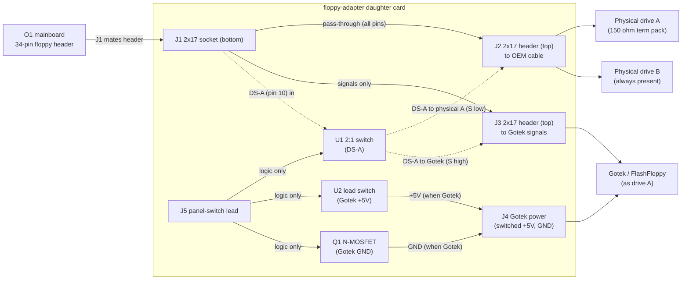

# O1NEXT Floppy Adapter (`floppy-adapter`) — switchable Gotek / physical-drive daughter card

**Status: Solved as a design.** Every decision this design needed is made (§8), the
Floppy Adapter's Rev A schematic is captured, wired, footprinted and checked, and
the board is ready for PCB floorplan and routing; nothing is built and nothing is
measured on hardware.

Design spec for issue **#62**. Tracks the floppy interposer personality (#20);
the disk-format position is settled in `docs/dd-upgrade-formats.md` (#95).
Derived from
`research/osborne1/floppy-adapter/` (Wayne Visser passive adapter + provenance),
Richard Loxley's Osborne Restoration parts 5 and 12–15, and
`hardware/floppy-adapter/README.md`.

**The switch is solid state — three silicon parts — decided 2026-10-22.** The case
has no height for relay blocks, so DS-A is switched by an **NC7SB3157P6X**, the
Gotek's +5 V by a **TPS22918** and its ground return by an **AO3400A** (§4.3,
§4.4). The fail-safe survives: the switch's own truth table parks the machine on
the physical drive. Rev A KiCad capture lives in `hardware/floppy-adapter/`
(`floppy-adapter.kicad_sch`, generated by `gen_floppy_adapter_sch.py`).

> **Vocabulary:** `Rev A` / `Rev B` in this document are the **Floppy Adapter's**
> revisions. That is an unrelated board to the interposer's Rev A / Rev B, so the
> letters always carry this board's name — see `hardware/README.md`.

## 1. Purpose

Let the user choose, from a front-panel switch, whether the **drive A** position
is served by the physical drive or by a **Gotek** (FlashFloppy) emulator, with
**drive B always present** in both modes. The card sits between the O1
mainboard/DD-board floppy header and the OEM floppy cable; nothing in the machine
or its cable is cut.

Prior art, deliberately **not** copied:

- Wayne Visser's `Osborne1FloppyAdapter` is a **passive** tap — it puts a Gotek
  on the bus alongside the physical drives and switches nothing. We keep its
  pin/rail mapping as the O1 interface reference.
- Richard Loxley's hand-wired build (parts 12–15) proved the concept but needed a
  DPDT switch + a 5 V relay soldered onto the Gotek, plus hand-cut Dupont cable.
  This design moves all of that onto a PCB at the connector end of the cable.

## 2. Osborne 1 floppy interface (34-pin, Shugart-like)

The O1 uses a Shugart-like 34-pin interface, but with **+5 V and +12 V routed to
the drives over otherwise-unused cable pins** — there are no separate drive power
connectors. The pin functions below are **read from the O1 mainboard schematic
itself** — DWG 1A2011-00 Rev E, sheet 9 of 9 (DISC CONTROLLER), the P8 symbol;
the same pinout is extracted in `docs/o1-mainboard-schematic.md` §5 — and they
agree with the archived Wayne Visser adapter
(`research/osborne1/floppy-adapter/FloppyAdapter.sch`), Loxley's signal audit and
the standard Shugart ordering for the shared signals.

| Pin(s) | Signal | Notes |
|---|---|---|
| 1,2,3,5,9,19,27,29,31,33 | GND | pin 7 is GND on the drive-end drawing instead; neither 2 nor 7 is a driven signal, so both are tied to GND here |
| **4** | **TG43** | **not GND** — FDC-driven; the drive's write-current-reduce input on 96 tpi drives |
| **6** | **EARLY** | **not GND** — FDC-driven |
| 7 | GND (drive-end drawing) | see note on pin 1 row |
| 8 | INDEX | |
| 10 | DS-A (drive select A) | **the switched line** — Gotek replaces drive A |
| 11,13,15,17 | +12 V | power-over-cable (physical drives) |
| 12 | DS-B (drive select B) | not switched — drive B stays present |
| 14 | *(not drawn on P8)* | |
| 16 | 4 MHz | O1-specific clock; not used by Gotek |
| 18 | DIRECTION | |
| 20 | STEP | |
| 21,23,25 | +5 V | power-over-cable (physical drives; tapped for Gotek) |
| 22 | WRITE DATA | |
| 24 | WRITE GATE | |
| 26 | TRACK 0 | |
| 28 | WRITE PROTECT | |
| 30 | READ DATA | |
| 32 | SIDE SELECT | |
| 34 | LATE | O1-specific |

Pins 4 and 6 carry live FDC outputs, so the card **passes them straight through
J1 → J2** rather than grounding them. This card switches the OEM cable through to
the physical drives, and clamping TG43 low would assert reduced write current
permanently; a Gotek-only adapter that grounds 2, 4, 6 and 7 does not have that
problem, which is the whole difference between the two.

The Gotek needs only the static/step/data lines plus its drive-select (Loxley's
11-line audit). The card routes that subset to the Gotek header and leaves 4 MHz
and the spare power pins off it.

## 3. Topology

Everything between J1 and J2 is a **straight pass-through** except pin 10
(DS-A), which is intercepted. The physical drives therefore see an unmodified
cable; the only difference is which device the machine's DS-A reaches.

## 4. Switching design

### 4.1 Drive-select routing (pin 10)
DS-A from the mainboard (J1.10) is U1's common. **Control low** connects it to
J2.10 → the physical A drive; **control high** connects it to J3.10 → the Gotek.
Never both — and U1's break-before-make guarantees that even during the changeover —
so the two devices cannot both answer as drive A. DS-B (pin 12) is untouched, so
drive B stays present and selectable in both modes.

### 4.2 Gotek power switching
Loxley's field notes (part 15) are decisive and are the reason this card exists:

- **Switching only +5 V does not turn the Gotek off** — the O1's pulled-up signal
  lines parasitically power the board through its input protection diodes.
- **Switching only GND makes the *other* drive unreliable** — the Gotek's signal
  lines are still referenced to the shared 5 V.
- **Switching both +5 V and GND works.** That is what this card does.

Consequence: the Gotek's **GND and +5 V must arrive only through J4**, *not*
through the J3 header, otherwise switching GND has no effect. J3 carries signals
only.

### 4.3 Switch element — DECIDED 2026-10-22: **solid state**, because there is no height for a relay

**The decision, and the constraint that decides it.** On **2026-10-22** the
maintainer settled the switch element as solid state, with a constraint this card
cannot argue with:

> **There is not enough height in the case for relay blocks.**

That is decisive, and it is not about price or availability. A DIP-14 signal relay
is ~10 mm tall; an industrial 4PDT on a socket is 35 mm. The card is a **mezzanine
between the logic board and the floppy harness**, and the machine has no room for
either. **Rev A is solid state** — three SMD packages, ~1.5 mm.

The distribution check agrees, independently: there is no 4PDT DIP signal relay in
production to design around. Omron **G6A-434P** / **G6A-474P** were discontinued
with a last-buy date of 2010-06-29, and the 4-pole DIP class went with them —
Panasonic **TQ4-5V** and **DS4E-S-DC5V** are broker-only at **$20–186** a piece.

| | relay — the option rejected | solid state — decided (Rev A) |
|---|---|---|
| height | ~10 mm DIP-14; 35 mm socketed | **three SMD packages, ~1.5 mm** |
| what the panel lead carries | 56–73 mA of coil current | **microamps** |
| DS-A | a contact pair | **NC7SB3157P6X**, ≤10 Ω, break-before-make |
| the two rails | two more contact pairs | **TPS22918** (52 mΩ) + **AO3400A** (28 mΩ) |
| fail-safe | de-energised → NC contact | **S low → B0 → the physical drive** |
| parts | 1 (unobtainable) or 2 | 3 + 4 passives |
| cost | $4–12 for two DPDT | **≈ $3** |
| click, and contact life | yes; 10⁵–10⁷ operations | none; no wear-out |

### 4.4 The three switches

Three parts, one control node (`CTRL`), and the same fail-safe the relay's NC
contact gave:

| Ref | Part | What it does |
|---|---|---|
| **U1** | **NC7SB3157P6X** — single 2:1 analog/bus switch, SC70-6 | picks which device owns DS-A. `A` is the machine's DS-A; **`B0` is the physical drive**, `B1` is the Gotek |
| **U2** | **TPS22918** — 5.5 V / 2 A load switch, 52 mΩ, SOT-23-6 | switches the Gotek's **+5 V**; `VIN` is the cable's 5 V, `VOUT` is `+5V_SW` |
| **Q1** | **AO3400A** — N-MOSFET, 28 mΩ at Vgs = 4.5 V, SOT-23 | switches the Gotek's **GND** return (`GND_SW`) |

**The truth table is the fail-safe, and it is the part's own.** The NC7SB3157's
datasheet says *S low → B0 connected to A; S high → B1 connected to A*, so wiring
B0 to the physical drive means a control that is low, floating, or has lost its
lead parks the machine on the real drive. R1 (10 kΩ) pulls `CTRL` down for the same
reason the relay design pulled the coil node down. The part also has
**break-before-make** select circuitry, so the two devices are never both connected
to DS-A even for an instant — the property the relay gave for free, and the one
that must not be lost in a solid-state version.

**Why these parts, and not the others.**

- **A bus switch on DS-A, not a 74HC4053 or CD4053.** The DS-A line is pulled up by
  1 kΩ on the Gotek side; a 70–120 Ω switch in series with that puts the low level
  at 0.7–0.9 V against a 0.8 V TTL threshold — a part that works on paper and fails
  on a machine. The NC7SB3157 is a 5 V rail-to-rail part at ≤10 Ω, and its control
  input tolerates 5 V independent of VCC.
- **A MOSFET on the ground return, not a second PhotoMOS.** An AQY212GS is 0.7 Ω,
  which at the Gotek's ~0.3–0.5 A is 0.2–0.35 V of ground offset between the Gotek
  and the machine's TTL signals — half the noise margin, on the read-data line. The
  AO3400A is 28 mΩ, which is **14 mV** at half an amp. (Two AQY212GS *would* have
  been the simplest possible build — two parts, no 5 V-level care — and this is the
  number that rules it out.)
- **A load switch on +5 V, not a discrete P-FET pair.** The TPS22918 is one part
  with a logic-level ON pin, 52 mΩ, and a configurable rise time; `CT` and `QOD` are
  left open (open `CT` is the fastest rise, open `QOD` disables the discharge). If
  the bench ever shows the Gotek lingering on power-down, `QOD` is the pin to come
  back to.
- **No flyback diode, and no coil.** The card has no inductive load, so there is no
  D1.

Both rails are switched, and for the reason §4.2 gives: +5 V alone leaves the
Gotek parasitically powered through the pulled-up signal lines, and GND alone upsets
the other drive. The relay-versus-silicon decision does not touch that — it decides
*what* switches the rails, not *which* rails are switched.

### 4.5 The panel switch, and the one lead that leaves the board

The panel end is a **flip switch: UP = the physical drives, DOWN = the Gotek.** It
is a plain SPST in series between the cable's +5 V and the control node, so:

| Switch | Lead | `CTRL` | DS-A goes to |
|---|---|---|---|
| **UP** (open) | floating, R1 pulls down | **low** | **the physical drive** |
| **DOWN** (closed) | tied to +5 V | high | the Gotek |

Up being the fail-safe position is not a coincidence of wiring — it is the same
property the relay's de-energised contact had, and it is why R1 exists. The lead
carries microamps (three CMOS inputs and a gate), where the relay's coil wanted
73 mA, and the two wires are interchangeable: reversing them changes nothing,
because an SPST in series with a gate input is symmetric.

**R5 (1 kΩ) is in series in that lead, and it is fitted, not deferred.** The lead
leaves the board and runs to the front panel, so it is the one net here that can
arrive carrying something the board never sent — a transient, or a short to
something else in the machine. 1 kΩ limits what that can push into three CMOS gates
and a FET gate; the FET's ~630 pF gate then turns in about a microsecond, which is
irrelevant for a switch a hand moves. R1 sits on the **control** side of R5, so the
fail-safe is unchanged: an unplugged lead is still a low.

**The card-end connector is DECIDED (2026-10-22): a bare 2-pin 2.54 mm header**, with
a female Dupont housing on a **twisted pair** of leads to the panel switch. The
maintainer's reasoning, recorded because it is the reason: *"just a pin header is
fine — an appropriate switch with a twisted pair dupont connector wire is trivial to
implement."* A series SPST has no polarity to key, the two wires are interchangeable,
and a lead that works loose fails to the safe position; twisting the pair is what
keeps the lead quiet next to the floppy cables.

**Considered and rejected**, recorded so it is not re-litigated: a shrouded **JST PH
2.00 mm** (`S2B-PH-SM4-TB`), the part the WiFi COMM PAC uses for its keyboard-adapter
power port, where the shroud and polarising slot are what remove the reverse-voltage
case. It would buy retention and no exposed 5 V pin, and cost PH housings and a crimp
— for a two-wire series switch that does not need either.

### 4.6 Termination and pull-ups (why drive A matters)
The O1 terminates the floppy bus with a **150 Ω resistor pack on every signal
line, located in physical drive A** — the drive at the far end of the cable.
Drive B has no termination (Loxley parts 5 and 12). Two consequences:

- The shared signal lines stay terminated in both modes, because only DS-A is
  switched: drive A remains connected to every other line, so its 150 Ω pack
  stays on the bus even when the Gotek is selected.
- **DS-A loses its pull-up in Gotek mode.** The 150 Ω pull-up lives at drive A;
  routing DS-A to the Gotek disconnects it. The Gotek has **1 kΩ pull-ups on most
  lines but none on the drive-select lines** (Loxley part 5), so a floating DS-A
  is exactly the failure Loxley chased for days.

→ **Add an on-card pull-up on the Gotek-side DS-A net** (U1's B1 → J3.10):
**1 kΩ default, with a 150 Ω option** (jumper or second footprint) to
match the O1's own termination. This is the single most important addition to
the design, and it exists only because the Gotek replaces drive A
rather than drive B. Loxley tried both 1 kΩ and 150 Ω on the select lines.

## 5. Reference schematic (Rev A, netlist level)

Components:

| Ref | Part | Notes |
|---|---|---|
| J1 | 2×17 socket, 2.54 mm | bottom, mates O1 mainboard header |
| J2 | 2×17 header, 2.54 mm | top, OEM cable → physical drives |
| J3 | 2×17 header, 2.54 mm | top, Gotek (signals only) |
| J4 | 4-pin header (floppy power) | switched +5 V / GND to Gotek |
| J5 | 2-pin header | front-panel switch lead — bare 2.54 mm pins for a Dupont housing; JST PH alternative in §4.5 |
| U1 | **NC7SB3157P6X**, SC70-6 | DS-A 2:1 switch (§4.4) |
| U2 | **TPS22918**, SOT-23-6 | Gotek +5 V switch; `CT`/`QOD` open |
| Q1 | **AO3400A**, SOT-23 | Gotek GND switch |
| R1 | 10 kΩ | control-node pull-down (fail-safe) |
| R5 | 1 kΩ | **in series in the switch lead** (§4.5) |
| R3 | 1 kΩ | DS-A pull-up, Gotek side, default (§4.5) |
| R4 | 150 Ω (DNP) | DS-A pull-up alternative — fit R3 **or** R4 (§4.5) |
| R2, D2 | 1 kΩ + LED (optional) | front-panel "Gotek active" indicator |

Connections (pin n of J1 unless stated):

- **Pass-through:** J1.n → J2.n for every pin **except 10**. This carries the
  signals *and* the +5 V / +12 V / GND rails to the physical drives unchanged.
- **DS-A:** J1.10 → U1 `A` (the common). U1 `B0` → J2.10 (physical A, the
  **S-low** throw). U1 `B1` → J3.10 (Gotek, the **S-high** throw).
- **DS-A pull-up:** R3 (1 kΩ default; 150 Ω option) from the J3.10 net to +5 V,
  on the Gotek side of the switch (§4.5).
- **Gotek signals:** J1 pins 8, 18, 20, 22, 24, 26, 28, 30 (and optionally 32, 34)
  → the matching pins of J3. J3 pins 12, 14, 16 and all GND/power pins are **NC**.
- **Gotek +5 V:** J1 +5 V (21/23/25) → U2 `VIN`; U2 `VOUT` → J4 (+5 V).
- **Gotek GND:** board GND → Q1 source; Q1 drain → J4 (GND).
- **Control:** J1 +5 V → J5.1 → (panel switch) → J5.2 → **R5** → `CTRL`, which drives
  U1 `S`, U2 `ON` and Q1's gate. R1 pulls `CTRL` to GND. **UP = physical drives,
  DOWN = Gotek** (§4.5). Optional R2+D2 from `CTRL` to GND for the indicator.

## 6. BOM (Rev A)

| Qty | Item | Notes |
|---|---|---|
| 1 | **NC7SB3157P6X** 2:1 analog/bus switch, SC70-6 | DS-A; ≤10 Ω, break-before-make. ~$0.35–0.60 |
| 1 | **TPS22918** load switch, SOT-23-6 | Gotek +5 V; 52 mΩ, 2 A. $1.60 @1, $0.51 @5 |
| 1 | **AO3400A** N-MOSFET, SOT-23 | Gotek GND return; 28 mΩ at Vgs = 4.5 V. ~$0.10 |
| 1 | 2×17 socket, 2.54 mm, vertical | bottom mezzanine |
| 2 | 2×17 header, 2.54 mm, vertical | top (cable + Gotek) |
| 1 | 4-pin header (floppy power) | Gotek power, right-angle |
| 1 | 2-pin header | panel switch |
| 1 | 10 kΩ TH | control-node pull-down (R1) |
| 1 | 1 kΩ TH | series resistor in the switch lead (R5) |
| 1 | 1 kΩ TH | DS-A pull-up (R3, default) |
| 1 | 150 Ω TH (DNP) | DS-A pull-up alternative (R4) |
| 1 | 1 kΩ + LED (DNP) | optional indicator |
| 1 | PCB, 2-layer, 1.6 mm | ENIG preferred (mating, hand-soldered SMD) |

## 7. Physical design brief

**Board (PCB).**
- 2-layer, 1.6 mm FR4; ground plane on the bottom layer; +5 V/GND traces
  ≥ 0.5 mm (Gotek ~0.3–0.5 A). The Gotek's return path now runs **through Q1**,
  so the GND_SW trace and Q1's pads carry that current too.
- Envelope to be fixed against the mainboard keep-outs
  (`research/osborne1/OCC1_1A2011-00_Schem_RevE.pdf`) and host photos
  (`research/pictures/`); target a compact card that clears the DD board. **Height
  is the binding constraint**, not area — it is what decided the switch (§4.3), and
  the three SMD packages are ~1.5 mm against a relay's 10 mm.
- J1 (socket) on the bottom face, positioned to engage the mainboard 34-pin
  header; add 2 mounting holes/standoffs so the mezzanine cannot rock.
- J2 and J3 on the top face; orient both so the OEM ribbon and the Gotek ribbon
  exit without fouling. Silk-label each connector, mark pin 1, and label
  "O1 IN", "→ DRIVES", "GOTEK", "GOTEK 5V", "SWITCH".
- Assembly is **mixed**: the connectors and the four passives are through-hole, the
  three switches are SOT-23/SOT-23-6/SOT-363. Order the boards with paste and a
  stencil or expect to hand-solder SC70 — it is the smallest part on the card.

**Gotek mount (3D-printed part).**
- The Gotek (top cover removed) fits a floppy storage pocket; with its top
  headers fitted it is too tall, so connect it by a slim pigtail/direct-wire pads
  rather than plugging a header on top.
- Design a printed bracket/faceplate that holds the Gotek in the pocket at the
  right depth, exposes the USB port, and carries the panel switch. This is the
  "Modification to support Gotek drives with 3D-printed floppy-disk faceplate"
  write-up planned in `site/README.md`.
**Cable egress from the floppy pocket — two accepted routes.**

The card itself sits at the logic-board connector, inside the machine. What has to
leave is the **Gotek run** (signals + switched power) and the **2-wire switch lead**,
and the pocket's ventilation slots are the constraint. Both of these are accepted,
and the maintainer's guidance is to pick one:

1. **Break the 34-pin run into parts that fit the ventilation slots** — Loxley's
   approach. The full-size ribbon is split into narrower runs (or pulled down to the
   reduced 12-line signal set of §5 plus the two power wires) so each part passes a
   slot, and they are rejoined inside the pocket. **Nothing on the machine is cut.**
   At the card end that is still a 34-way IDC socket onto J3, with only the needed
   conductors fitted — the unused positions simply carry no wire.
2. **Cut the case** to pass a full-size 34-pin cable, alongside the two switch wires.
   More work, irreversible, and it gives a clean unbroken ribbon with no joints to
   go intermittent.

The switch lead is two wires and passes either way; it is the ribbon that decides
which route is chosen. **Both routes need the same card**, so this does not change
the PCB — it changes what the builder does at the pocket, and it is why J3 is a full
2×17 header rather than a 12-pin one: the cable that arrives may be either.

**Panel switch.**
- Plain panel-mount **SPST flip switch: UP = physical drives, DOWN = Gotek**
  (§4.5). 2-wire lead to J5 through **R5**; the lead carries microamps, never drive
  power. Mount next to the Gotek pocket so the up/down reading matches the
  machine's own "which drive" convention.

**Reversibility.** No cable or machine modification: unplug the card and the
machine is stock.

## 8. Decisions, and what each one rests on

All eight are closed, and two of them — item 3 (the switch) and item 8 (the switch
connector) — were settled by the maintainer rather than by a session. Each carries
the evidence it rests on; the two that remain bench-verifiable are flagged as such.

1. **Drive topology — CONFIRMED (user, 2026-10-10).** The switch selects **drive
   A** (physical A ↔ Gotek); **drive B stays present** in both modes.

2. **Connector genders — CONFIRMED.** The O1 logic board's floppy connector is
   **P8, a 34-pin MALE header**. The Field Service Manual (2F00040) instructs
   "Attach the disk harness to the 34-pin connection on the logic board … Be
   careful not to bend any pins", and the double-density adaptor's "sockets …
   fit onto the logic board disk harness connector (P8)". The harness is a
   **female IDC socket** and is **not keyed** — "the RED stripe on the harness
   must be to the RIGHT" fixes pin 1. Therefore **J1 = female 2x17 socket**
   (card bottom) and **J2 = male 2x17 header** (OEM cable). Pin order is
   confirmed in §2.

3. **Switch element — SETTLED BY THE MAINTAINER, 2026-10-22: solid state.** The
   decision, and the constraint that decides it:

   > **There is not enough height in the case for relay blocks.**

   ~10 mm for a DIP-14 signal relay, 35 mm for a socketed industrial one, on a card
   that is a mezzanine between the logic board and the floppy harness. So: **three
   silicon parts** (§4.4) — **NC7SB3157P6X** for DS-A, **TPS22918** for the Gotek's
   +5 V, **AO3400A** for its ground return — ~$3, no coil, no click, no height. The
   fail-safe survives: the switch's own truth table is *S low → B0*, and B0 is the
   physical drive. The distribution check agrees: **Omron G6A-434P** / **G6A-474P**
   were discontinued in 2010, and the whole 4-pole DIP class with it (Panasonic
   TQ4-5V and DS4E-S-DC5V are broker-only at $20–190).

4. **Isolation depth — DECIDED: Loxley's proven minimum.** Switch **DS-A + both
   power rails** and nothing else. The shared signal lines are *not* additionally
   gated: doing so adds series elements to a 4 MHz-class bus for no proven
   benefit, and the failure Loxley actually chased (a Gotek that would not power
   down) is fixed by the dual-rail switch alone. Full signal gating is recorded
   as a Rev B experiment, not Rev A scope.

5. **DS-A pull-up — CONFIRMED 1 kΩ default, 150 Ω option.** The FSM settles the
   termination location: "The A drive has an 8 pin 150 OHM Terminator resistor
   pack. B DRIVE DOES NOT." So when DS-A is routed to the Gotek it loses the
   O1's 150 Ω pull-up, and the Gotek has no pull-up on its drive-select lines
   (Loxley part 5). The card therefore fits **R3 = 1 kΩ** as the default and
   **R4 = 150 Ω** as an alternative footprint (fit exactly one) on the
   Gotek-side DS-A net.

6. **Gotek drive-select jumper — SETTLED (bench-verify).** The Gotek must answer
   the O1's **drive-A** select, which is cable **pin 10**. The Gotek manual
   labels the jumpers `S0 = Drive Select 0` / `S1 = Drive Select 1`, and
   FlashFloppy's generic guidance for a Shugart host is "unit 0 → place the
   selection jumper at **S0**". The O1, however, straps its drive A as **DS1**
   (FSM 8.1.4.11: "Drive A has a jumper at positions HM and DS1"), and the
   proven O1 adapter (`WayneVisser/Osborne1FloppyAdapter`) notes "Jumper only
   **S1** on the GoTek". **Start with S1**; if the Gotek is not seen, move to
   S0. This is a 30-second bench check and the card is agnostic to it.

7. **Gotek cable route / bracket — DECIDED.** Gotek in the **right-hand floppy
   storage pocket** (Loxley part 14), driven from a **reduced ~12-line pigtail**
   that passes the pocket vent slots (a full 34-pin ribbon does not fit), with a
   3D-printed faceplate/bracket carrying the Gotek and the panel switch. This is
   the "Modification to support Gotek drives with 3D-printed floppy-disk
   faceplate" write-up planned in `site/README.md` (§7). The two accepted egress
   routes — break the 34-pin run into parts that pass the slots, or cut the case for
   a full-size cable — are in §7, and the card is the same either way.

8. **Panel-switch connector — DECIDED BY THE MAINTAINER, 2026-10-22: a bare 2-pin
   2.54 mm pin header.** *"just a pin header is fine — an appropriate switch with a
   twisted pair dupont connector wire is trivial to implement."* The lead is a
   series SPST (§4.5), so there is no polarity to key and the two wires are
   interchangeable; the shrouded JST PH alternative is recorded in §4.5 as
   considered-and-rejected rather than left open.

### The evidence §8 rests on

- **O1 Field Service Manual 2F00040** (`research/osborne1/`): 150 Ω terminator is
  on drive A only; logic-board connector P8 is male; harness not keyed, red
  stripe = pin 1; drive A strapped DS1.
- **O1 mainboard schematic, DWG 1A2011-00 Rev E sheet 9 of 9 (DISC CONTROLLER)**
  (`research/osborne1/OCC1_1A2011-00_Schem_RevE.pdf`, PDF page 12): the P8
  34-pin header — GND = `1,2,3,5,9,19,27,29,31,33`; +12 V = 11,13,15,17;
  +5 V = 21,23,25; **pin 4 = TG43 and pin 6 = EARLY, neither is GND**; pins 7
  and 14 are not drawn at all; DS-A/DS-B on 10/12. Read at 600–1200 dpi; see
  `docs/o1-mainboard-schematic.md` §5 (#62).
- **O1 disk-electronics schematic, DWG 1A3004-00/01 Rev C sheets 1–3** (PDF
  pages 1–3 of the same file — a *different* drawing, the drive's own board):
  head/drive connectors P1/P2; P2 lists GND = `1,3,5,7,9,19,27,29,31,33` and
  CASE = 32. It disagrees with P8 on pin 2 versus pin 7, which is harmless —
  neither is a driven signal on the O1, so the card ties both to GND.
- **Gotek SFR1M44-U100K user manual**: jumper table `S0 = Drive Select 0`,
  `S1 = Drive Select 1`, `MO = Motor On`, `JA = READY on 34-pin interface`.
- **FlashFloppy wiki — Initial Setup / Gotek Models**: Shugart hosts expect
  unit 0 → jumper `S0`.
- **Omron G6A-434P** datasheet: 4PDT DIP-14 through-hole relay; 5 VDC coil =
  72.5 mA / 69 Ω / ~360 mW; contacts 1 A 30 VDC (ST-US). The part is **obsolete** —
  G6A-434P and G6A-474P were discontinued with a last-buy date of 2010-06-29, and
  the 4-pole DIP class went with them (§4.3).
- **Maintainer, 2026-10-22 — the constraint that decides the switch:** *"There is
  not enough height in the case for relay blocks."* Recorded verbatim because it is
  the load-bearing fact: the card is a mezzanine, and a DIP-14 relay is ~10 mm and a
  socketed industrial 4PDT is 35 mm. It settles §4.3 without reference to price
  or availability.
- **NC7SB3157 / FSA3157 datasheet** (Fairchild, Rev 1.0.4 — read as text, not as a
  PDF figure): function table **"Logic Level Low → B0 connected to A; Logic Level
  High → B1 connected to A"**; pin assignments in SC70-6 **1 = B1, 2 = GND,
  3 = B0, 4 = A, 5 = VCC, 6 = S**; 1.65–5.5 V VCC, <10 Ω typical on-resistance,
  rail-to-rail signal handling, control input tolerant to 7 V, and
  **break-before-make** select circuitry. The truth table is what makes B0 the
  fail-safe throw, and the break-before-make is what keeps the two devices from
  ever sharing DS-A.
- **TPS22918 datasheet and product page** (TI SLVSD76C): 1–5.5 V in, 2 A, 52 mΩ at
  5 V, **N-channel switch with a charge pump**, adjustable rise time on `CT`, and a
  configurable quick-output-discharge `QOD`. The DBV-6 pinout used here
  (`1 VIN, 2 GND, 3 ON, 4 CT, 5 QOD, 6 VOUT`) is the one KiCad's own library carries
  for **TPS22917DBV**, the same package and family.
- **Distribution check, 2026-10-22** (DigiKey / Newark / LCSC / TME via their
  product pages and the Findchips and Octopart aggregators): G6A-434P-ST-US and
  G6A-474P-ST-US obsolete; TQ4-5V broker-only $20–31 CAD; DS4E-S-DC5V
  broker-only $21–186. In production and stocked: **AQY212GS** (Newark $3.05 @1,
  $2.22 @100); **TPS22918** ($1.60 @1, $0.51 @5, $0.15 @6k); **SN74CBT3257**
  ($1.13 @1); and, for the relay routes that were considered and rejected,
  **G6S-2 DC5** (Newark $6.00 @1, $4.65 @100), **HFD2/005-S-L2** (Newark $2.20 @1,
  $1.66 @100), **FTR-B4CA005Z** (Electro Sonic $2.37 @50), **MY4N-DC12-S**
  (TME $7.78 @12) and Finder 55.34 (TME $13.59 @1).

- **Richard Loxley, Osborne Restoration parts 5 and 12–15**: 150 Ω pack at the
  far drive; Gotek has 1 kΩ on most lines but not on drive select; switching
  only +5 V leaves the Gotek parasitically powered, only GND upsets the other
  drive — switch both.

## 9. Rev A schematic capture

Captured 2026-10-10 as `hardware/floppy-adapter/floppy-adapter.kicad_sch`,
generated by `gen_floppy_adapter_sch.py`. **Rewired, footprinted and re-verified
2026-10-22** — the same treatment the WiFi COMM PAC got (#347) — and then
**re-captured the same day for the solid-state switch** (§4.3, §4.4).

- **J1** female 2x17 socket (O1 logic-board P8), **J2** 2x17 header (OEM cable),
  **J3** 2x17 header (Gotek signals), **J4** 1x04 header (switched Gotek power),
  **J5** 1x02 header (panel switch), **U1** NC7SB3157P6X (DS-A), **U2** TPS22918
  (+5 V), **Q1** AO3400A (GND), **R1** control pull-down, **R3/R4** DS-A pull-up,
  **R2+D2** optional indicator (R2, D2 and R4 are `dnp` — on the board, not in the
  BOM).
- Every J1 pin except DS-A (10) is **drawn straight through to J2**. DS-A goes to
  U1's common; its **B0** throw returns to J2.10 and its **B1** throw goes to
  J3.10. `+5V_SW` and `GND_SW` reach the Gotek only via U2/Q1 → J4; the J3 header
  is signals-only, and +12 V, 4 MHz and pin 14 never reach the Gotek.

### The capture's guarantees, and the hazards it removes

| the hazard | the capture |
|---|---|
| a net **label on every pin**, and no wire between any two parts | **every net drawn** as orthogonal segments on a 1.27 mm grid, routed by the Manhattan A* in `gen_floppy_adapter_sch.py` |
| 103 labels doing the connecting | **one label per signal net** (21), so the names survive and a missing wire *breaks* the netlist instead of being hidden |
| `GND`/`+5V`/`+12V` as labels | routed like signals, with **one power symbol per rail** — a symbol per pin would stack 3.81 mm glyphs 2.54 mm apart on J1's eleven ground pins — plus a **PWR_FLAG** per rail |
| every `Footprint` field empty | **13 of 13 assigned**, from KiCad's own libraries |
| a 4PDT relay, `K1`, with no footprint and logical pin numbers | **three silicon switches** whose pin numbers are the parts' own (§4.3, §4.4) |
| nothing regenerated or compared | `tools/check_schematics.py` now asserts the **pinout of J1 and J2**, **which throw of U1 is which device**, the control node's three consumers, the connector and switch footprints, and that the committed file matches its generator |

Verified, not asserted:

- `kicad-cli sch export netlist` matches §5's net table; `kicad-cli sch erc
  --severity-all` is **0 errors / 19 violations**, all 19 the one kind (embedded
  `local:` symbols, one per placed symbol).
- `kicad-cli sch upgrade` — the operation that detached 14 pins on the WiFi board
  — leaves the netlist **identical**. 0 overlapping and 0 duplicate collinear
  segments, because the generator normalises its own geometry.
- `python3 tools/check_schematics.py --board floppy-adapter` and
  `python3 tools/check_boards.py` pass.

Three defects came out of the capture, all found by comparing netlists rather
than by looking at the sheet:

1. **A wire ended on a no-connect pin.** The router blocked other nets' pins but
   not the pins marked no-connect (they carry no net, so they are not in the
   net-holding table), and the first wired netlist grew `J3.14` and `K1.11` onto
   `FLP_DS_A_GOTEK`. A no-connect marker says the pin goes *nowhere*; the netlist
   believes the wire. The sibling generator in `hardware/wifi-comm-pac/` had the
   same latent hazard and was given the same fix.
2. **`tools/check_schematics.py` was carrying a pinout table that contradicted
   the design** — it read "pins 2/4/6 are GND" against §2's "pins 4 and 6 are
   TG43 and EARLY, never ground". Nothing called the table, so nothing noticed;
   it is now the check for J1 and J2, which is what makes it true or false.
3. **The relay's pin numbers were placeholders and its footprint was missing**,
   which is what the switch decision above finally closed — with the parts' own
   pin numbers, taken from their datasheets and cross-checked against KiCad's
   library symbols.

### State: the schematic is complete — the next step is the PCB

Every decision this design needed is made (§8), every net is drawn, every part has a
footprint, and the two things that were left hanging — the switch part and the
switch connector — are closed. **The board is ready for PCB floorplan and routing**,
which is the next unit of work: place the connectors on their faces, set the
keep-outs against the mainboard and the pocket, and route it.

The one thing the floorplan must respect is the reason the switch is silicon: **height
is the binding constraint**, and the three switch packages are ~1.5 mm against a
relay's 10 mm.

## 10. References
- Issue #62 (this design); feeds #20 (floppy interposer). Disk formats:
  `docs/dd-upgrade-formats.md` (#95).
- `research/osborne1/floppy-adapter/` — Wayne Visser passive adapter + PROVENANCE.
- `research/osborne1/OCC1_1A2011-00_Schem_RevE.pdf` — mainboard schematic.
- `hardware/floppy-adapter/README.md` — concept summary.
- Richard Loxley, Osborne Restoration **part 5** (150 Ω term pack at the far
  drive; Gotek has 1 kΩ on most lines but *not* drive select) and **parts 12–15**
  (A drive has 150 Ω, B has none; DPDT + relay switching lesson).

