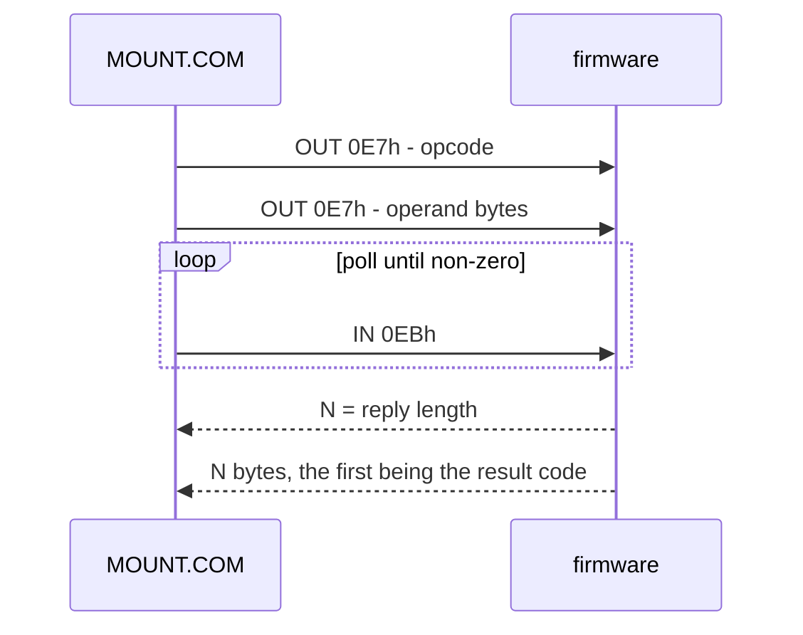

# The mailbox — the interposer's host↔firmware channel (#155)

**Status: design — a proposal.** Nothing is built, and nothing here has been
measured on hardware. This is the contract the firmware and the Osborne-side
tooling agree on *before* either exists, so that `MOUNT.COM` (#27) and the clock
publisher (#18) are not written against an interface that accretes implicitly
out of the first implementation.

Answers **#155**. Serves **#27** (MOUNT.COM), **#20** (image library), **#18**
(RT-60A time service), **#16** (firmware). Built from
`docs/o1-memory-io-map.md` §3–§4 and §7, `docs/virtual-peripherals-block-diagram.md`
§2–§3, `docs/copower88-protocol.md`, and `docs/drive-c-design.md` §4.2.

## 1. What the mailbox is, and what it is not

**One channel.** The interposer is a single device in the Z80 socket, and every
piece of the machine's own software that needs to *ask* it something uses this
one port pair. It is the interposer's control plane: commands in, metadata out.

The list of clients is short, and that is the point — most personalities do not
need it at all:

| Client | Needs | Home |
|---|---|---|
| **`MOUNT.COM`** (#27) | enumerate the image library, mount/unmount, report status | `software/mount-com/` |
| **the resident clock publisher** (#18) | read the clock the interposer keeps | `software/rt60a-clock/` |

| Personality | Touches the mailbox? | Why |
|---|---|---|
| `floppy-emulator` (#20) | **only through `MOUNT.COM`** | the flux engine is bus-level; the library is what needs a client |
| `drive-c-gpib` (#22) | **no** | driven by the original `DCL`/`DFD.SPR` over IEEE-488 |
| `rt60a-rtc` (#18) | **yes** — one command | the time service has no ROM driver of its own |
| `virtual-printer` (#19) | **no** | IEEE-488 device 3, driven by the ROM's driver |
| `screenpac-video` (#24) | **no** | passive: it snoops the bus and never answers a cycle |
| `copower88-shim` (#23) | **no** | must answer **SWP's own** port pair, because the period driver does the talking (`docs/copower88-protocol.md`) |
| `zimodem-fork` (#21) / the external WiFi modem (#56) | **no** | entirely ACIA-controlled at `2A00`/`2A01`; the ROM mediates, the host never sees the modem |
| the keyboard adapter (#47) | **no** | it has no host software at all — HID in, matrix out |
| the **standalone Drive C reproduction** (#84) | **no** | it is an IEEE-488 box, and it is *never fitted at the same time as the interposer* |

Two of those deserve spelling out, because they are what keeps this protocol
small:

- **The standalone Drive C box and the interposer are mutually exclusive.** They
  both exist to be the machine's storage; nobody will run both. So the mailbox
  never has to arbitrate with the box, and `MOUNT.COM`'s "Drive C" target is
  always the **interposer's own** `drive-c-gpib` personality (§6).
- **The modem and the keyboard need nothing from us.** The modem is behind the
  6850, and the keyboard adapter is a standalone HID→matrix injector with no
  CP/M-side presence. Neither is a mailbox client, so neither shapes the
  protocol.

**And the O1NG is the same machine.** `hardware/o1ng/` puts the interposer on the
same board as the rest of the machine rather than in the Z80 socket — but the
bus, the address map and this port pair are unchanged, so a mailbox client
written against this spec runs on a stock machine with a fitted interposer and on
the O1NG-SFF without modification.

## 2. Where it lives: a Z80 I/O port pair, not a bank-2 memory window

**The requirement that decides it:** `MOUNT.COM` is an ordinary CP/M 2.2 `.COM`
file. CP/M loads it at `0100h` and it runs in the **TPA**, with **bank 1**
selected.

That rules out the memory-mapped window. The O1's onboard I/O lives at
`2000–2FFF` in **bank 2** (`o1-memory-io-map.md` §2–§3) — but bank 2 also maps
the **ROM** over `0000–3FFF`, which is where the TPA is. A program at `0100h`
cannot select bank 2 without the very next instruction fetch coming back as ROM
bytes. This is not an accident of the O1: it is *why* every onboard device is
reached through the ROM, and why the ROM holds the eight IEEE-488 drivers and the
FDC routines. A TPA program touches the FDC by calling the BIOS, never by writing
`2100h`.

**So the mailbox goes in I/O port space.** `IN`/`OUT` is not banked, an ordinary
TPA program reaches it directly, and there is precedent on exactly this kind of
machine: SWP's CoPower-88 driver is a CP/M utility that talks to its board
through a port pair with bit-0 polling and `OUTI` block transfers
(`docs/copower88-protocol.md`). This is a **deliberate exception** to
`o1-memory-io-map.md` §7's "decode bank-2 I/O space" recommendation: that
reasoning is about personalities the *ROM* drives (the modem behind the ACIA, the
printer behind the IEEE-488 driver). The mailbox is the first thing a **TPA
program** has to reach, and it needs a different home for that reason.

### 2.1 The port decode hazard, and how the port numbers dodge it

Banking is controlled by **writes** to I/O space, decoded by UD10 on `A1:A0`
only, with the data bus ignored (`o1-memory-io-map.md` §4, measured):

| `A1:A0` of any `OUT` | Effect |
|---|---|
| `00` | select **bank 2** (ROM + I/O window) |
| `01` | select **bank 1** (main RAM) |
| `10` | set `BIT 9` → map the **dim-bit bank** into `F000–FFFF` |
| `11` | clear `BIT 9` → map bank 1/2 back |

Only `A1:A0` reaches the decode, so **every** port address aliases one of
`0x00–0x03` — the machine's own I/O decode has no port devices at all. Two
consequences:

- **`IN` is harmless.** UD10 is wired to `WR`. Reading any port touches nothing.
- **`OUT` is not.** A write that leaks to UD10 moves the bank state — and a
  leaked `BIT 9` *set* would map the attribute RAM over the video RAM and corrupt
  the screen.

So both mailbox ports are chosen **≡ 3 (mod 4)**. A write that leaks is then
`Clear BIT 9` — clearing an already-clear latch, which is idempotent and does
nothing. The pair is *not* adjacent, and that is deliberate: the adjacency of the
CoPower's `7Eh`/`7Fh` is not free on this machine.

| Port | Direction | Purpose |
|---|---|---|
| **`0xE7`** | host → firmware (`OUT`) | request: opcode, then its operand bytes |
| **`0xEB`** | firmware → host (`IN`) | reply: `0` = not ready, else the reply length, then the bytes |

Deliberately avoided: `0x00–0x03` and every alias of them (the bank latch), and
`7Eh`/`7Fh` / `FEh`/`FFh` (the CoPower-88's own pairs, which the interposer may
have to emulate or coexist with — `virtual-peripherals-block-diagram.md` §3).

**The protocol is base-relative.** The two numbers are a firmware constant and
one line in `MOUNT.COM`; if a measurement on hardware says otherwise, only those
two lines move.

## 3. The transaction

Polled, byte-at-a-time, single-master. The Z80 is the only thing on the bus that
initiates anything, so there are no interrupts, no DMA and no FIFOs to size.

1. The host writes the **opcode** to `0E7h`, then its **operands**, in order, one
   `OUT` per byte.
2. The host polls `0EBh`. A read of `0` means *not ready, poll again*. A read of
   `N > 0` is the **reply length**, and the next `N` reads are the reply bytes.
3. `reply[0]` is always a **result code** (§4.1); `reply[1..]` is the payload.
   `0` is reserved as "not ready", so a reply is never empty — even `NOP`
   answers with the one-byte result code.
4. Writing to `0E7h` while a reply is pending **abandons it** and starts a new
   transaction. That is the recovery path, and it means a wedged host cannot
   wedge the firmware. A host that loses track mid-request recovers with a single
   `NOP`: an opcode the firmware does not know is answered with `01h` and resets
   the operand count, so there is always a way back to a known state.

**No bulk channel, ever.** The mailbox carries commands and metadata. A Drive C
blob is 384 KiB and a floppy image is ~200–400 KiB; neither crosses this port.
The *mount* is firmware-side — FAT32 → record store — and the host only names
which one (§6). Stated here so that nobody designs a bulk path by accident.

**Presence probe.** There is no "device present" bit to read, because an absent
interposer leaves the port answering whatever the floating bus gives — not a
value we can rely on. The probe is therefore an **echo**: send `ECHO` (opcode
`01h`) with one operand byte and require the same byte back, twice, with two
different patterns. A machine with no interposer fails that; a machine with one
cannot. This is the "probe mailbox, clean error" behaviour
`software/mount-com/README.md` asks for.

## 4. The command set

Opcode space is partitioned by **device class**, so a second client does not
require a protocol revision:

| Opcode | Name | Operands | Reply payload (after the result code) |
|---|---|---|---|
| `00–0Fh` | *mailbox* | | |
| `00h` | `NOP` | — | — (reset: abandon a partial request, answer `OK`) |
| `01h` | `ECHO` | 1 byte | that byte, echoed |
| `02h` | `ID` | — | protocol version, device id (2 bytes) |
| `10–1Fh` | *image library* (#20, #27) | | |
| `10h` | `COUNT` | — | entry count, `u16` little-endian |
| `11h` | `GET` | index, `u16` little-endian | one 24-byte entry record (§5.1) |
| `12h` | `MOUNT` | index `u16`, drive `u8` | drive state `u8` |
| `13h` | `UNMOUNT` | drive `u8` | drive state `u8` |
| `14h` | `DSTATUS` | drive `u8` | state `u8`, entry index `u16`, flags `u8` |
| `20–2Fh` | *clock* (#18) | | |
| `20h` | `GETTIME` | — | `YY MM DD hh mm ss dow`, binary, 7 bytes |
| `30–3Fh` | *reserved* | | |

Drives are `0` = `A:`, `1` = `B:`, `2` = **Drive C** (the interposer's own
`drive-c-gpib` personality). Entry indices are `u16`, so the library is capped at
65 535 blobs by the protocol and by nothing else.

### 4.1 Result codes (`reply[0]`)

| Code | Meaning |
|---|---|
| `00h` | OK |
| `01h` | unknown opcode |
| `02h` | wrong operand count |
| `03h` | index out of range (`GET`, `MOUNT`) |
| `04h` | drive out of range |
| `05h` | entry not mountable — wrong kind for the drive, or the size is not a valid one for its kind (§5.2) |
| `06h` | media error — the blob could not be read |
| `07h` | busy — a flux window is open on the floppy personality; try again |
| `08h` | nothing mounted on that drive |

## 5. Listing — the requirement that shapes the protocol

`MOUNT.COM`'s job is to let a user **pick** a blob, and it cannot offer a menu of
things it cannot enumerate. That single requirement is what decides the shape of
this protocol: the mailbox needs a **read direction with a variable-length
answer**, not just a "mount this" write.

A one-shot transaction cannot carry a listing. A reply is length-prefixed and
bounded at 255 bytes, and the library is not: it grows with what the user drops
on the microSD. Two designs were considered:

**Design A — a streaming cursor** (`LIST` opens, `NEXT` returns the next entry,
`END` closes): **rejected.** The cursor is state the firmware has to own, and it
has to survive — or be reset after — a host that crashes, is Ctrl-C'd, or is
reloaded from disk, which is how CP/M starts a program *every* time. It also
turns "show me that one again" into a seek rather than an index.

**Design B — index-addressed records** (`COUNT` returns N, `GET i` returns entry
*i*): **chosen.** It is stateless in the firmware — the only thing the host needs
is an integer, and the host already has to keep one to know which entry the user
picked.

Design B also gives the bounds for free: every reply is exactly one 24-byte
record, so no reply can approach the 255-byte field, and `GET i` for `i >= COUNT`
returns code `03h` — a defined end-of-list, with no separate "is there a next"
flag. The menu is then literally `COUNT`, then `GET 0 … GET N-1`.

### 5.1 The entry record — 24 bytes, fixed

| Offset | Bytes | Field |
|---|---|---|
| 0 | 16 | `NAME` — the identifying name, upper case, NUL-padded |
| 16 | 1 | `KIND` — `0` floppy image, `1` Drive C blob |
| 17 | 1 | `FLAGS` — bit 0 `VALID`, bit 1 `MOUNTED`, bits 2–7 reserved (0) |
| 18 | 4 | `SIZE` — `u32` little-endian, bytes |
| 22 | 2 | reserved, 0 |

Fixed-size records are the whole point: the host can compute where entry *i*
lives, the firmware can serialise one without a buffer, and the reply length is
always 25 (result code + 24).

### 5.2 `KIND` and `SIZE` — size *is* the geometry

| `KIND` | Mounts to | Valid sizes |
|---|---|---|
| `0` — floppy image | `A:` / `B:` | per the G2 multi-format table (#95) |
| `1` — Drive C blob | Drive C | **exactly 196 608** (192K) or **393 216** (384K) |

For a Drive C blob the file length **is** the geometry
(`docs/drive-c-design.md` §4.2), so a wrong-sized file is not a near-miss — it is
invalid, and there is no "close enough". It is still **listed**, with `VALID`
clear, rather than hidden: a user who has copied the wrong file onto the card
needs to *see* it in the menu and be told why it will not mount, and `MOUNT`
refuses it with code `05h`.

### 5.3 The four questions the listing opened

The comment on #27 listed four things a listing forces a decision on. These are
the decisions:

1. **Where does the name come from?** The **CP/M-visible 8.3 identity**, upper
   case — 12 bytes at most, which is why `NAME` is 16. FAT32 long names are *not*
   carried: the machine is 52 columns wide and CP/M thinks in 8.3, so the long
   name is a web-UI nicety and the short name is the identity. If a long name
   ever matters, it is a second, optional field and a protocol version bump.
2. **How does a variable-length listing cross the mailbox?** It does not. It is
   `N` fixed-size records addressed by index (§5).
3. **How big is the mailbox, and is it ever a data channel?** Commands and
   metadata only, never a data channel (§3). A 384 KiB blob is moved by the
   firmware, Pico-side, and the host never sees the bytes.
4. **What does the menu look like?** One line per entry on a 52×24 screen:
   `NAME`, `KIND`, `SIZE`, plus a marker for what is mounted. Paged, with the
   entry index as the selection key. The 80/104-column switch (#81) and the
   machine's own graphics set (`o1-chargen-graphics.md`) are optional polish —
   the protocol does not depend on either, and MOUNT.COM must be readable at 52
   columns.

## 6. Mount semantics

- **The mount is firmware-side.** The host names an *index* and a *drive*; the
  firmware copies FAT32 → the record store (for Drive C) or sets up the flux
  source (for `A:`/`B:`). The host moves nothing.
- **Drive C is the interposer's own personality.** Because the standalone Drive C
  reproduction and the interposer are mutually exclusive on one machine (§1),
  `MOUNT.COM` never has to consider a real box on P3: drive `2` is always
  `firmware/drive-c-gpib/`.
- **A mounted blob is already installed.** A blob saved from a working unit
  carries `DCLOADED.SYS` and `DRIVEC.SYS`, and the vendor loader is idempotent
  (`docs/drive-c-design.md` §4.1) — so mounting it is enough; the host does not
  re-run `DCL.COM`.
- **Busy is a real answer.** Mounting to `A:`/`B:` while the flux engine is
  mid-window returns `07h` rather than corrupting state — the radio-jitter rule
  in `firmware/README.md`, expressed as a protocol result rather than a stall.
- **Unmount is explicit.** `UNMOUNT` ejects; a warm boot does not, because the
  firmware's state outlives the host's — the same argument as
  `docs/drive-c-design.md` §4.1, one layer down.

## 7. What is not decided

1. **The port numbers themselves.** `0E7h`/`0EBh` are a proposal, chosen for the
   reasons in §2.1. They are confirmed (or corrected) by measurement, and the
   protocol is base-relative, so nothing else moves with them.
2. **Whether the interposer suppresses the claimed cycle from the mainboard.** It
   can, and for a memory window the design already requires it
   (`virtual-peripherals-block-diagram.md` §2). It is *not* a blocker here: the
   `≡ 3 (mod 4)` choice makes a leaked write idempotent, so the worst case is a
   no-op rather than a corrupted screen. Worth measuring anyway with
   `tools/check_o1_map.sh` (#64) once a board exists.
3. **Whether `SETTIME` belongs here at all.** The *publisher* (#18) only needs to
   read the clock; setting it is the web UI's job, over HTTP, and adding a write
   path for symmetry would be a mistake. The opcode space is reserved; the
   command is not defined.
4. **Whether the printer ever wants a status command.** It is ROM-driven and
   needs nothing today; `30–3Fh` is held open for it rather than guessed at.

## Sources

- `docs/o1-memory-io-map.md` §2–§4 — the banks, the memory-mapped I/O window, and
  the measured 2-bit port decode that decides §2.1; §7 — the free windows, and the
  bank-2 recommendation this doc deliberately excepts.
- `docs/virtual-peripherals-block-diagram.md` §2–§3 — the snoop/override
  mechanism, and the port-base strategy that avoids the CoPower-88's pairs.
- `docs/copower88-protocol.md` — the precedent: a CP/M utility talking to a
  peripheral over a port pair, with bit-0 polling and block `OUTI`.
- `docs/drive-c-design.md` §4.1–§4.2 — why a blob needs no re-install, and why its
  size *is* its geometry.
- `firmware/README.md` — the radio-jitter rule that becomes result code `07h`.
- `software/mount-com/README.md`, `firmware/floppy-emulator/README.md` — the
  consumers that were written against an unspecified port.

