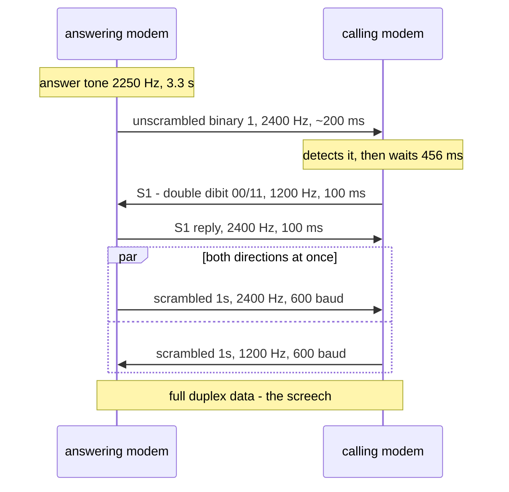
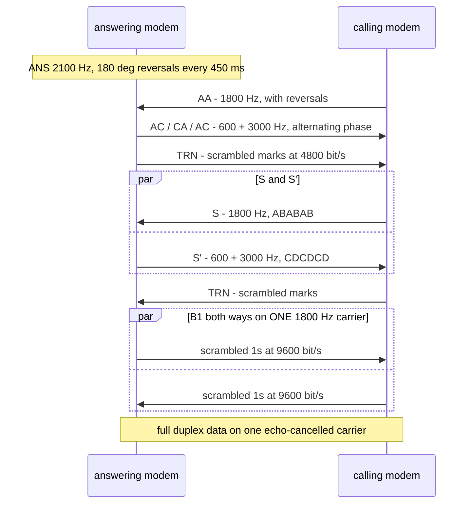

# The modem's sound — 300 / 1200 / 2400 / 9600 handshake tones

**Status: solved, with one named uncertainty.** The tones, the rates and the order
of each handshake are documented and each is cited below; the one thing not
confirmed against a primary source is the **scrambler preset** (§7). The code is
`firmware/zimodem-fork/o1modem/tone.c`, and it is host-tested and listenable
without a board.

Tracks **#322** (the panel and the noise, part of **#56**); the board is
**#324/#325**. Derived from nothing in `research/` except the Comm-Pac manual — the
rest is published standards, cited in §9.

## 1. Why this document exists

The WiFi COMM PAC has a speaker (U8, a MAX98357A on an I²S bus) and #322 asks it
to make **the noise a modem makes**, not a one-note buzzer. That means the panel
has to be able to produce four different handshakes — 300, 1200, 2400 and 9600 —
and the only way to know what each one sounds like is to know what each one *is*.

There is a distinction running through this whole document, and it decides
arguments:

> **The frequencies are the specification. The durations are ours.**

A 2250 Hz answer tone is not negotiable: it is what a 2400-bps modem sounds like,
and a 2100 Hz answer tone is what a 9600-bps modem sounds like, and the difference
is audible to anyone who was there. But whether our answer tone lasts 3.3 s or
2.0 s is a **taste** question, because the audience is a person in the same room
and not a USR Courier at the other end of a phone line.

So: **this is not a modem.** Nothing here interoperates, nothing here needs to
meet an ITU timing tolerance, and `tone.c` does not implement equalisers, echo
cancellers or trellis decoders. What it implements is the **vocabulary** —
which tones, at which rates, in which order — and it plays a two-second data
phase after the handshake because that is the part everyone remembers.

## 2. How to read the confidence in this file

Per `docs/README.md` §"House rules" 3:

| Mark | Means |
|---|---|
| **read** | Quoted or transcribed from a primary source — the standard itself, or this project's own archive |
| **secondary** | From a reference work or a driver implementation that is not the standard |
| **ours** | Chosen here, and stated as a choice rather than a fact |

Where two sources disagree — and for the V.22 answer tone they do — §4 says which
one was taken and why.

## 3. The four standards at a glance

| | **300** | **1200** | **2400** | **9600** |
|---|---|---|---|---|
| Standard | **Bell 103A** (V.21 is the ITU cousin) | **Bell 212A** / V.22 | **V.22bis** | **V.32** |
| Modulation | FSK | 4-phase DPSK | 16-point QAM | TCM, 32-point |
| Symbol rate | 300 baud | 600 baud | 600 baud | 2400 baud |
| Bits per symbol | 1 | 2 | 4 | 4 (trellis-coded) |
| Data rate | 300 bit/s | 1200 bit/s | 2400 bit/s | 9600 bit/s |
| Carrier — low | 1270/1070 Hz | 1200 Hz | 1200 Hz | — |
| Carrier — high | 2225/2025 Hz | 2400 Hz | 2400 Hz | **1800 Hz** |
| Answer tone | **none** (see §4) | 2250 Hz | 2250 Hz | 2100 Hz + reversals |
| Direction separation | split band | split band | split band | **echo cancellation** |

The last row is the one that makes 9600 sound different from the rest. V.22,
V.22bis and Bell 103 are **split-band**: two carriers at once, one each way, and
the "two tones fighting" quality everyone remembers *is* the split band. V.32
cancels the echo instead and runs **one** 1800 Hz carrier in both directions, so
its sound is a single signal being pushed around. `tone.c` models that difference
with a `two` flag on each phase, and the suite asserts every V.32 phase has it
clear.

## 4. 300 baud — Bell 103A, and it is the Osborne's own

This is the only rate in this document that the project's **own archive**
documents, and it is the machine's native one, so it is quoted rather than
paraphrased. `research/osborne1/Comm-Pac_Users_Manual.pdf` — *Osborne Comm-Pac
User's Manual*, part no. 2F-00145-00 — §"(a) Modem-to-Modem Protocol" (**read**):

> The Osborne Datacom Modem uses the **Bell 103-A protocol** to transmit data by
> **Frequency Shift Keying (FSK)** over voice-grade telephone lines. The
> modem-to-modem protocol is a design feature of the modem PC board which cannot
> be changed. Binary states (1,0) are defined as **(1270 Hz, 1070 Hz) for
> ORIGINATE mode** and **(2225 Hz, 2025 Hz) for ANSWER mode**.

And its own specification block, on the facing page (**read**):

| | |
|---|---|
| Data format | serial, asynchronous binary, **up to 300 bits per second** |
| Modulation | FSK |
| Carrier — mark | 1270, 2225 Hz |
| Carrier — space | 1070, 2025 Hz |
| Operation | full duplex over two-wire, unconditioned telephone lines |
| Transmit level | −10 dBm into a 600 Ω load |
| Receive sensitivity | 0 dBm to −43 dBm into a 600 Ω load |
| Compatibility | "Bell System 103A compatible in Originate or Answer mode" |

**Bell 103 has no answer tone**, and this is the trap. There is no 2100 Hz and no
2250 Hz anywhere in it: the answering modem goes off-hook and simply *starts
sending its mark frequency*, and that continuous 2225 Hz is what the caller hears
while the call is being set up. A generator that invented an answer tone for the
300-baud case would produce a sound that no Bell 103 modem ever made — and would
produce it for the one rate the Osborne itself used.

So the score's "carrier" phase for 300 is a plain 2225 Hz tone, named as the
answer *mark* rather than as a tone.

**V.21, the ITU cousin** (**secondary** — from Frank Durda IV's modulation table,
§9): 300 baud FSK, channel 1 (the originate direction) at **980/1180 Hz** and
channel 2 (the answer direction) at **1650/1850 Hz**. The US market preferred
Bell 103, which is why this board's score is the Bell pair and why V.21 is not in
`tone.c` — it is a table away if a non-US machine ever needs it.

### What the 300-baud score plays

| ms | Phase |
|---|---|
| 2000 | answer mark, 2225 Hz — *"there is no answer tone in Bell 103"* |
| 500 | the calling modem answers with its mark, 1270 Hz |
| 500 | both carriers up, 2225 + 1270 Hz |
| 2000 | **300 baud, both directions** — 2225/2025 against 1270/1070 |

The last phase is the only one in any of the four scores where the data phase is
genuinely **two independent FSK streams summed**, and that is exactly what a
300-baud call sounded like: four tones, two of them moving.

## 5. 1200 baud — Bell 212A / V.22

600 baud with four phases, two bits per symbol, 1200 bit/s. Split band: the
originating modem transmits on **1200 Hz** and the answering modem on **2400 Hz**
(**secondary** — Frank Durda IV's table, §9, which is where the 600-baud /
four-point row comes from; the modulation is differential, which is what lets a
receiver lock without an absolute phase reference).

### The answer tone, and a disagreement between sources

| Source | Says |
|---|---|
| Oracle's Enterprise SBC VBD tone table (§9) | "V.22/V.22bis (**2250 Hz**)" and "V.22/V.22bis (**2250 Hz + 1800 Hz**)" |
| 3am Systems' V.22 / V.22bis pages (§9) | "Answer tone, with phase reversals (**2100 Hz**, from answering modem)" |

**2250 Hz was taken**, for three reasons: the Oracle table is a *detector* table
and names the standard explicitly; 2100 Hz is the **V.25** answer tone and belongs
to the V.32 family, so a 2100 Hz "V.22bis" is very likely a capture of a different
device or a transcription slip; and 2250 Hz is the value that matches what a
2400-bps modem actually sounded like. The 3am pages are annotated spectra of
recorded calls, and a recorded call can contain a V.25 tone from something else on
the line.

**This is a named uncertainty, not a settled fact** — re-check it against the ITU
text if anyone has the V.22bis PDF to hand. It is recorded here rather than
smoothed over because the whole point of this document is that the frequencies are
the specification.

### The handshake, from the standard's own words

ITU-T V.22bis sets out the calling modem's procedure step by step, and spandsp's
`v22bis_tx.c` reproduces it verbatim in a comment (**read** — the quote is the
standard's text, transcribed by a reference implementation):

> **b)** After **155 ± 10 ms of unscrambled binary 1** has been detected, the modem
> shall remain silent for a further **456 ± 10 ms** then transmit an **unscrambled
> repetitive double dibit pattern of 00 and 11 at 1200 bit/s for 100 ± 3 ms**.
> Following this signal the modem shall transmit **scrambled binary 1 at
> 1200 bit/s**.
>
> **c)** If the modem detects scrambled binary 1 in the high channel at 1200 bit/s
> for **270 ± 40 ms**, the handshake shall continue … However, if unscrambled
> repetitive double dibit 00 and 11 at 1200 bit/s is detected in the high channel,
> then at the end of receipt of this signal the modem shall apply an ON condition
> to circuit 112.

**The "unscrambled repetitive double dibit pattern of 00 and 11" is the S1
signal**, and it is the most recognisable sound in this document: a two-state
phase alternation on the low-band carrier, 100 ms long, sent by the *calling*
modem after a deliberate silence. Both the 1200 and the 2400 scores carry it,
which is what makes a V.22bis call sound like a V.22 call for its first second and
a half.

`o1_bitpat_bit(O1_BIT_DOUBLE_DIBIT, …)` reads out `0,0,1,1,0,0,1,1` and
`test_o1modem.c` asserts exactly that — because "the pattern is 00 and 11" is a
claim in a comment otherwise.

### What the 1200-baud score plays

| ms | Phase |
|---|---|
| 3300 | answer tone, 2250 Hz |
| 200 | unscrambled binary 1, high band (2400 Hz) |
| 456 | the calling modem waits 456 ms — the standard's number |
| 100 | **S1**: unscrambled double dibit 00/11, low band |
| 100 | S1 reply, high band |
| 400 | scrambled 1s at 1200 bit/s, both bands |
| 2000 | **full communications, 1200 bit/s** |



## 6. 2400 baud — V.22bis

The same split band and the same 600 baud as V.22, but **sixteen points instead of
four**: four bits per symbol, 2400 bit/s (**secondary** — the modulation table in
§9). V.22bis was adopted in 1984.

The handshake is V.22's **plus** the switchover, and the switchover is the
interesting part (**read**, same transcription as §5):

> **d)** **600 ± 10 ms** after circuit 112 has been turned ON the modem shall begin
> transmitting **scrambled binary 1 at 2400 bit/s**, and **450 ± 10 ms** after
> circuit 112 has been turned ON the receiver may begin making **16-way
> decisions**.
>
> **e)** Following transmission of scrambled binary 1 at 2400 bit/s for
> **200 ± 10 ms**, circuit 106 shall be conditioned to respond to circuit 105 and
> the modem shall be ready to transmit data at 2400 bit/s.

So a V.22bis modem **sounds like a V.22 modem for the first second and a half of
every call**, and then changes gear. That is not a simplification on our part — it
is the standard, and it is why the V.22 interworking phase is in *this* score and
not in the 1200 one. The three training intervals are 600 + 450 + 200 ms, which is
why that phase is 800 ms in the table and named with the numbers.

### What the 2400-baud score plays

| ms | Phase |
|---|---|
| 3300 | answer tone, 2250 Hz |
| 200 | unscrambled binary 1, high band |
| 456 | the calling modem waits 456 ms |
| 100 | **S1**: double dibit 00/11, low band |
| 100 | S1 reply, high band |
| 600 | V.22 interworking — still 1200 bit/s until the switchover |
| 800 | scrambled 1s at 2400 bit/s — the 600 + 450 + 200 ms of training |
| 2000 | **full communications, 2400 bit/s** |

## 7. 9600 baud — V.32

A completely different animal, and the score says so. **V.32 has one carrier, not
two**: echo cancellation separates the directions instead of splitting the band,
so the sound is a single **1800 Hz** signal being pushed around. 2400 baud with
trellis-coded 32-point modulation at 9600 bit/s (V.32, adopted 1984; V.32bis
extends it to 14 400 with 128 points).

The handshake, signal by signal, from the General DataComm patent that describes
it in order (**read** — `WO1991015067A1`, §9) and the annotated spectra at 3am
Systems and wavecom (**secondary**):

| Signal | From | What it is |
|---|---|---|
| **ANS** | answering | **2100 Hz**, with **180° phase reversals every 450 ms** |
| **AA** | calling | **1800 Hz**, same reversal treatment |
| **AC / CA** | answering | **600 + 3000 Hz**, alternating phase — round-trip-delay measurement for the echo cancellers |
| **TRN** | both | "scrambled marks sent at **4800 bps**" — the training sequence. At 2400 baud that is two bits per symbol, so it is QPSK |
| **S** | both | "**ABABAB…**" — the 1800 Hz signal with its phase flipped every symbol interval, for **256 symbol intervals** |
| **S′** | both | "**CDCDCD…**" — the same idea on the 600 + 3000 Hz pair |
| **B1** | both | scrambled binary 1 at the line rate — where the screech starts |

**The phase reversals are not decoration.** They exist to disable the network's
echo cancellers, which would otherwise eat a full-duplex data signal; Wikipedia's
"Answer tone" article has the 450 ms number (**secondary**), and the patent shows
the answering modem sending ANS "for one or more seconds" before the calling modem
responds with AA.

`tone.c` implements the reversal by **adding half a cycle to the phase
accumulator** rather than by negating the output. Arithmetically the same thing,
but it keeps one accumulator and one code path — and the discontinuity at the
reversal is the point, because that is what the far end detects.

### What the 9600-baud score plays

| ms | Phase |
|---|---|
| 1800 | **ANS**: 2100 Hz, 180° reversals every 450 ms |
| 300 | **AA**: 1800 Hz, calling modem, with reversals |
| 300 | **AC/CA/AC**: 600 + 3000 Hz, answering modem, alternating phase |
| 300 | **TRN**: scrambled marks at 4800 bit/s, answering modem |
| 215 | **S**: 1800 Hz, ABABAB…, 256 symbol intervals |
| 300 | **TRN**: scrambled marks, calling modem |
| 215 | **S′**: 600 + 3000 Hz, CDCDCD… |
| 400 | **B1**: scrambled 1s at 9600 bit/s |
| 2000 | **full communications, 9600 bit/s** |



## 8. The scramblers, and the one thing that could not be confirmed

**The scrambler is why a modem sounds like a modem.** Unscrambled data at
1200 bit/s has structure you can hear — tones, patterns, silence. Scrambled data
is flat noise with the carrier buried in it, and that hiss *is* the sound everyone
remembers. So the polynomials matter more than anything else in the data phase.

| Standard | Polynomial | Taps |
|---|---|---|
| V.22 / V.22bis / Bell 212A | G(x) = **1 + x⁻¹⁴ + x⁻¹⁷** | 14, 17 |
| V.32 / V.32bis | G(x) = **1 + x⁻¹⁸ + x⁻²³** | 18, 23 |

**secondary** — the EE-terminology reference (§11) gives both as "the generating
polynomial for the CRC", which is the same shift register wearing a different hat:
a scrambler and a CRC read the same taps out differently. The suite asserts both
by their **period** (2¹⁷ − 1 = 131 071 and 2²³ − 1 = 8 388 607), which is a
property only the right exponents have — so the taps are proved, not transcribed.

### The named uncertainty: the preset

The standards **preset** these scramblers, and the tempting reading is "to all
ones". That reading is wrong for our purposes, and working out why is worth
recording:

> With the register full of ones, the feedback is 1 ⊕ 1 = **0**, so an input of 1
> passes straight through and the output is a **constant**. From an all-zeros
> preset the register converges to all-ones within 17 bits and does the same
> thing. So a scrambler preset to either extreme, fed ones, produces a **steady
> carrier** — indistinguishable from the *unscrambled* ones it is supposed to
> differ from.

`tone.c` therefore presets to a **single 1 in the lowest stage**, which avoids the
degenerate orbit and gives the maximal-length sequence. **The exact preset is a
detail this project could not confirm from a primary source**, and it is stated
here as a choice with its reason rather than presented as a quotation. The
property the sound needs — "scrambled 1s sound like noise, unscrambled 1s sound
like a carrier" — is what the choice delivers, and `test_o1modem.c` asserts it by
counting ones and zeros in 4000 scrambled bits.

## 9. Call progress, and DTMF

These are **not** modem handshakes and they are not ITU; they are North American
call-progress values (**secondary**), plus two sounds that are **ours**.

| Sound | Tones | Duration | Source |
|---|---|---|---|
| Dial tone | **350 + 440 Hz** | 3000 ms (looped) | the US precise tone plan |
| Ring | **440 + 480 Hz** | **2000 ms on, 4000 ms off** | the US audible ring cadence |
| Connect | 1200 → 1800 Hz | 120 + 200 ms | **ours** |
| Disconnect | 1800 → 900 Hz | 120 + 300 ms | **ours** |

A real modem has no "connected" chirp. Inventing one that sounds like a period
machine is the entire point of a panel that has a speaker, so the two are rising
for connect and falling for disconnect and are never confused in a room.

**DTMF** is the standard 4×4 grid — the eight tones are **697 / 770 / 852 / 941**
(low group) and **1209 / 1336 / 1477 / 1633 Hz** (high group), and a digit is the
intersection. `o1_dtmf_tones()` returns the pair for `0-9`, `*`, `#` and the A–D
column the keypad never had.

### The dial fingerprint — `ATDT` becomes audible

**The connect string is dialled.** On `ATDT <string>`, the whole string after the
`ATDT` is hashed, the hash becomes a short run of DTMF symbols, and those symbols
are played at the **very start** of the sequence. Two hosts sound different, the
same host always sounds the same, and you can hear which one you dialled.

| | |
|---|---|
| Hash | **FNV-1a, 64-bit** — asserted against the *published* reference vectors ("" is `0xcbf29ce484222325`, `"foobar"` is `0x85944171f73967e8`) rather than against its own output |
| Symbols | **10 to 15**, default **12** — 48 bits, a birthday collision at ~16 million destinations |
| Which bits | the **high** nibbles: FNV-1a's carries travel upward, so its low bits are the weak ones and a truncated high half is the better half to keep |
| Alphabet | the **16 DTMF symbols**, indexed by nibble — `0-9`, then `*`, `#`, `A`, `B`, `C`, `D` |
| Timing | 60 ms tone, 40 ms gap, **no gap after the last digit** — a gap separates two digits, and a trailing one would delay admission for a silence nobody ever heard |

**Why the alphabet is `*` and `#` rather than E and F.** DTMF has exactly
**sixteen** symbols and hex has exactly sixteen digits, so a nibble maps 1:1 and
four bits per tone is possible. The two keys the keypad has and hex does not —
`*` and `#` — stand in for the two digits hex has and the keypad does not. The
alternative is a base-14 alphabet and a longer dial for the same collision budget,
which is strictly worse.

Worked example, and it is a test:

```
"foobar"              -> FNV-1a 64 = 0x85944171f73967e8 -> 85944171D739
"bbs.example.net:23"  -> 669DB0#30*#A
```

**The admission gate.** A connection is **not admitted until the dial has finished
*and* the link is up** — either order, so a fast host is waited for and a slow dial
is waited out. The two facts arrive from different places (the sound engine and the
network), so `o1_dial_gate` holds them rather than inferring them, and
`o1_dial_gate_admitted()` is the only question the connect path asks.

An **unarmed** gate admits immediately: a session that was never dialled — an
incoming call, a phonebook entry, a plain `ATD` — has no dial to wait for, and that
is what keeps an ordinary connection ordinary. `o1_dial_gate_abort()` is "the
attempt failed" and starts the next one clean; a link that drops *after* admission
is a **disconnect**, not a gate event.

**One thing this does not own: the timeout.** If the link never comes up, the gate
never admits — which is correct, and it means the connect path still needs its own
"No carrier" timeout. The gate decides *when* a connection may be announced; it
does not decide when to give up.

**What the caller must get right.** The string is hashed **exactly as given**, so a
caller that trims whitespace has to trim it the same way every time. A leading
space is a different destination, and it is the only way this can be subtly wrong.

### When it makes a sound: `ATM`, and the `T` in `ATDT`

**The sound is a command, not a default.** Two axes, and they are deliberately
separate:

- **`ATM` is Hayes' monitor-speaker control** — a *setting*, which survives from
  one call to the next. Zimodem already *accepted* `ATM<n>` and threw it away
  (`zcommand.ino`, `case 'm': result = isNumber ? ZOK : ZERROR;`), so the command
  existed and did nothing. This fork is the first thing in the tree that can make
  a sound, so it now does the thing it says.
- **The `T` in `ATDT` is the per-call request.** `ATD` is silent and `ATDT` is
  not, which makes "do I want to hear this one" the operator's decision on the
  line rather than a configuration somebody has to find first.

| | M0 off | M1 until carrier | M2 always | M3 dial only |
|---|---|---|---|---|
| the dial | no | if `T` | if `T` | if `T` |
| the connect | no | if `T` | if `T` | no |
| a ring | no | yes | yes | no |
| the disconnect | no | no | yes | no |

**A mute wins**: `M0` silences a `T`, because a mute that a per-call flag can
override is not a mute. **A ring or a disconnect needs no `T`**, because neither
is a dial — there is nothing to ask for.

**`M1` and `M2` differ, and the difference is the disconnect.** "On until
carrier" means exactly that: once the carrier is up the speaker is off, so the
sound of the call *ending* is silent under M1 and audible under M2. That is the
one place on this panel where the two modes part, and the reason to choose M2 if
you want to hear the line drop. There is no data-mode noise in either — a real
"M2" means the data is audible for the whole session, and this panel plays a
finite score and stops, so M2 buys the disconnect and not a carrier hiss. Saying
that is better than inventing a sound nobody asked for.

**`M3` is the mode the sources disagree about**, and it is recorded rather than
smoothed over: [Lammert Bies](https://www.lammertbies.nl/comm/info/hayes-at-commands)
has "speaker on only while answering (not on all modems)",
[modemhelp.net](https://www.modemhelp.net/basicatcommand.shtml) has "enable
speaker after dialing but disable after a carrier signal is detected", and
[w4zt.com](https://w4zt.com/testeqdocs/hayes.html) says outright that "M3 is also
common, but different on many brands". We take the modemhelp reading, because it
is the one that describes something a *dialling* panel can actually do. **M0, M1
and M2 agree in all three sources.**

**Option (c): what "admitted" means, and what waits.** `ATDT` opens the socket,
switches the stream and returns `CONNECT` **while the tones are still playing** —
the machine gets its carrier immediately and nothing stalls. What waits is the two
things that mean "the connection exists" to everything *watching*:

- **the CD lamp** and the connect sound, held in `checkOpenConnections()`;
- **the `CONNECT` text**, which `case ZCONNECT:` skips while a dial is running.

`loop()` releases both, through `o1nextDialPoll()`, the moment the gate admits —
and it runs the same steps in the same order those two places would have, so an
admitted dial and a connection that was never dialled are indistinguishable
afterwards. A dial that fails aborts the gate (`o1nextDialFailed()`), so there is
nothing left to wait for and the next attempt starts clean.

**A mute in the middle of a dial does not hang the connection.** Every way a dial
can end — the score finishing, a new sound replacing it, or `ATM0` cutting it
short — goes through one place that marks the gate's "the tones have finished"
fact. A gate left waiting for tones that will never resume would hold the
connection open for the rest of the session.

**Two consequences worth knowing.**

- **A phonebook dial hashes the *resolved* address.** `ATDT 5` looks entry 5 up
  and dials *its* address, so the fingerprint identifies the destination rather
  than the number — the same host sounds the same whether it was typed out or
  dialled by number. That is the better of the two readings for a sound whose job
  is "you can hear which one you dialled", and it is a choice rather than an
  accident. The caller's `T` survives the lookup: whether this operator wants to
  hear the dial is a property of the *call*, not of the entry.
- **The speaker mode is per-session.** `ATM` sets it and nothing writes it to the
  config, so it is M1 again after a reboot. It does survive `ATZ`, because nothing
  here resets it — a mute that survives a reboot is still open work on #322.


## 10. What is ours, and what is deliberately absent

Everything in this section is a **choice**, stated so nobody later mistakes it for
a standard:

| Ours | Why |
|---|---|
| The **durations** of the answer tones (3.3 s, 1.8 s) | a taste question; the audience is a person in the room |
| The **2-second data phase** at the end of every score | the brief: *"and 2 seconds of full communications"* |
| The **QAM constellations** — a 4×4 grid for 16 points, and the 6×6 grid *minus its four corners* for 32 | real constellations rather than a rectangle of convenience, and the corner removal is where a 32-point cross gets its power efficiency |
| The **two independent bit streams** in a full-duplex phase | a real call has two senders; identical streams make both carriers move in lockstep, which sounds like one modem with an echo |
| The **payload text** | it is scrambled, so nobody can hear it — but a capture that is decoded later should explain itself |
| Connect / disconnect chirps | see §9 |
| The **speaker policy** — M1 by default, `ATD` silent, `M3` read as "dial only" | see §9; the sources disagree about M3, and a mute beats a `T` |
| The **phonebook dial hashing the resolved address** | so one host sounds the same typed out or dialled by number — see §9 |

Deliberately **absent**, because none of it changes the sound and all of it is
work:

- **Equalisation, echo cancellation, trellis encoding.** V.32's data phase is
  modelled as a 32-point constellation at 2400 baud on 1800 Hz, which is the right
  *shape*, not a conformant encoder.
- **The V.32 rate negotiation** (the `R1/R2/R3` and `E` sequences). They are 16-bit
  scrambled patterns that sound like more of the same, and every phase that
  carries a recognisable sound is present.
- **Differential decoding.** The V.22 phase is differentially *encoded* — that is
  what makes S1 a two-state alternation — but nothing decodes it, because nothing
  here receives.
- **V.21, V.23, V.29, Bell 202.** Each is a row in a table; none is a rate this
  machine or this panel needs.

## 11. Sources

| Source | Used for |
|---|---|
| `research/osborne1/Comm-Pac_Users_Manual.pdf` (in-repo; part 2F-00145-00) | **Bell 103A** — the originate/answer tone pairs, 300 bps, FSK, levels. The only rate documented by this project's own archive |
| ITU-T **V.22bis** §6.3.1.1.1 b–e, as transcribed in the comment block of `src/v22bis_tx.c` in [freeswitch/spandsp](https://github.com/freeswitch/spandsp) | the **S1** double-dibit signal, the 155 / 456 / 100 ms timings, the 600 + 450 + 200 ms switchover |
| Oracle **Enterprise Session Border Controller** documentation, "Modem Tone Detection" (the VBD tone table) | the **2250 Hz** V.22/V.22bis answer tone, and the contrast with plain **ANS 2100 Hz** |
| Frank Durda IV, *Data/FAX Modem Transmission Modulation Systems* ([mirror](http://major.butt.care/mirrors/nemesis.lonestar.org/reference/telecom/modems/modulations.html)) | carriers, baud rates and constellation sizes for Bell 103 / 202 / 212A and V.21 / V.22 / V.22bis / V.32 |
| 3am Systems technical library, [V.22](https://www.3amsystems.com/Technical_library/V22) · [V.22bis](https://www.3amsystems.com/Technical_library/V22bis) · [V.32](https://www.3amsystems.com/Technical_library/V32) | handshake annotations and modulation summaries. **Disagrees with Oracle on the V.22bis answer tone — see §5** |
| Wikipedia, [Answer tone](https://en.wikipedia.org/wiki/Answer_tone) | the **450 ms** 180° reversal interval, and why it exists (echo-canceller defeat) |
| General DataComm, **WO1991015067A1** ([Google Patents](https://patents.google.com/patent/WO1991015067A1/en)) | the V.32 handshake signal by signal: ANS → AA → AC/CA → S/S′ → TRN, and "256 symbol intervals" |
| wavecom, [Handshaking](https://www.wavecom.ch/content/ext/DecoderOnlineHelp/worddocuments/handshaking.htm) | the 12-phase annotated V.32 call |
| eeterms, [V-series definitions](https://www.eeterms.com/terms/v.html) | the two **scrambler polynomials** |
| Awinic **AW9523B** datasheet table 13, via Adafruit's `Adafruit_AW9523` and the Linux `pinctrl-aw9523` driver | the panel's dim-register map — in `panel.c`, not here |
| Hayes' **`M`** command — [Lammert Bies](https://www.lammertbies.nl/comm/info/hayes-at-commands) · [modemhelp.net](https://www.modemhelp.net/basicatcommand.shtml) · [w4zt.com](https://w4zt.com/testeqdocs/hayes.html) | the speaker modes **M0 / M1 / M2 / M3**, and the **M3 disagreement** between the three — see §9 |

## 12. The code, and how to hear it

| | |
|---|---|
| The generator | `firmware/zimodem-fork/o1modem/tone.c` — an integer phase accumulator, a quarter-wave table, two modulators; no floats and no libm |
| The scores | the same file: four `o1_phase[]` tables and the `o1_handshake` structs over them |
| The dial | the same file: `o1_fnv1a64`, `o1_dtmf_fingerprint`, `o1_dtmf_dial_build` and `o1_dial_gate` — the `ATDT` fingerprint and the rule that a connection is not admitted until it has finished |
| The speaker | the same file: `o1_sound_policy` — Hayes' four modes and the `T` in `ATDT`, as one table in one place, so the sound is decided in one place rather than at eleven call sites |
| The proof | `firmware/zimodem-fork/o1modem/run_tests.sh` — measures the *rendered output*: zero crossings for the four answer tones (2225 / 2250 / 2250 / 2100 Hz to ±2%), and a Goertzel filter for the DTMF (both tones present, the three they do not use down by 500×) |
| The ear | `firmware/zimodem-fork/o1modem/render_wav.sh` — writes nine `.wav` files to `build/modem-tones/` (gitignored), including one dial, so the sound can be tuned before any hardware exists |

```sh
firmware/zimodem-fork/o1modem/run_tests.sh -v      # the frequencies, measured
firmware/zimodem-fork/o1modem/render_wav.sh        # ... and then listen
```

The renderer exists because *"does it sound like a modem"* is a question no
assertion can answer, and the tests exist because *"is the answer tone 2250 Hz"* is
a question an ear cannot answer reliably. They are different questions, and #322
needs both answered.
