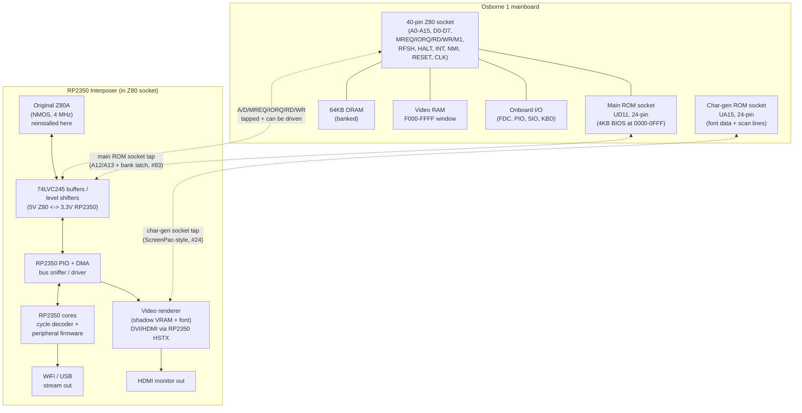
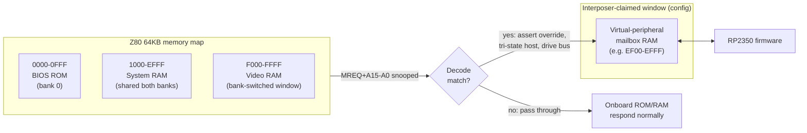
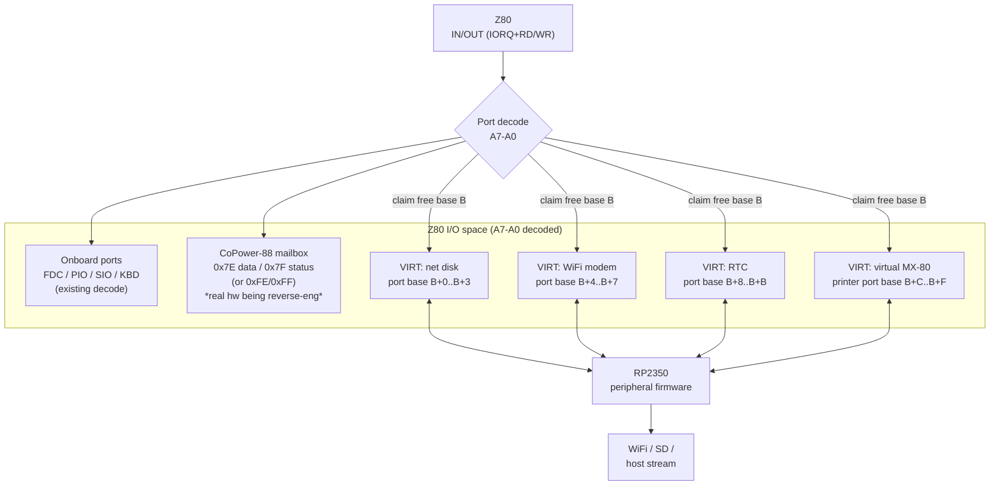
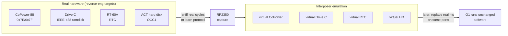

# O1 Interposer — Virtual Peripherals: Bus & Address-Space Block Diagram

How the RP2350 interposer sits on the Z80 bus and where each virtual
peripheral lives in the Osborne 1 memory and I/O maps.

## 1. Where the interposer physically sits

The Osborne 1 exposes the Z80 on a 40-pin DIP socket. Like the
CoPower-88 and the OCC ScreenPac, the interposer **plugs into the Z80
socket** and the Z80 plugs into the interposer — so it sees (and can
drive) every bus cycle.

**Tap points: three.** The interposer sits in the Z80 socket, so it already has
the bus; the other two are socket lead-sets, and between them they supply the two
things the bus cannot.

| Tap | Socket | Gives | Serves |
|---|---|---|---|
| bus | Z80, 40-pin | every cycle, including all video-RAM writes | all personalities |
| **ROM** *(added 2026-10-13)* | **main ROM, UD11, 24-pin** | `A12`/`A13` and a bank-latch strobe — the lines a 24-pin 2732 socket does not carry | **ROM 2.00 (#83)**, one image, any OEM-faithful mainboard |
| font | char-gen, UA15, 24-pin | the font, read-only | the HDMI video personality (§5), #44 |

The ROM tap is what makes a banked ROM possible at all: a part in the 24-pin
socket can never be more than 4 KB on its own, because the socket has no `A12`,
no `A13` and no write strobe. With the tap, the interposer can either serve the
ROM 2.00 image from its own flash or drive a 27128 in the socket. The SFF board
grafts the same decode in, so it runs the same image with no interposer.

**One host to design for.** An existing **OEM board + interposer** is equivalent to
an **LFF board + interposer**, because the LFF board is a faithful recreation of
*just* the OEM board with the Dual Density upgrade built in. Nothing in this
document needs a separate LFF case.

**Level shifting note (#11):** the host Z80A is NMOS (confirmed, date
8408). NMOS outputs are TTL-ish; NMOS inputs have ~2.0–2.4 V high
thresholds. Use **74AHCT/74HCT toward the Z80** (TTL-compatible inputs)
and **74LVC245 host-side**. ScreenPac used raw 74HC; we prefer AHCT/LVC
for margin across all three target machines.

## 2. Z80 memory map and where virtual devices attach

The O1 banks ROM, RAM, and video in a 64KB space. The interposer claims
a small decode window by **snooping MREQ and either passing through or
overriding** the onboard response.

**The ROM window is claimable too, and that is new.** With the main-ROM socket
tap (§1) the interposer holds the ROM window's `A12`/`A13` and a bank-latch
strobe, so **`1000–1FFF` becomes a 4 KB banked window** the interposer can fill —
which is how ROM 2.00 (#83) fits 11776 bytes of monitor + CCP + BDOS + CBIOS into
a machine whose ROM window is only 8 KB. The latch is written at **`2300h`** while
bank 2 is selected (`docs/o1-rom-2.0.md` §4.3). The 4 KB the video RAM does not
use is not the only spare space on this machine; the ROM mirror is another.

### Banking caveat
The O1 video RAM and BIOS share the top of the map via a bank-select
I/O bit. Any memory-resident virtual device must **(a)** live in an
address range the current bank exposes and **(b)** defer to the real
video RAM when it is mapped in. Safest is a small mailbox page in the
always-present RAM region, or an I/O-port device instead (below).

## 3. Z80 I/O map and the virtual-peripheral ports

I/O-mapped devices are cleaner: they never collide with the memory
banks and are how every real O1 peripheral (and the CoPower-88) already
works.

**Port-base strategy:** pick a base `B` in a region the onboard decode
leaves free **and** that does not collide with the CoPower-88's
0x7E/0x7F (Kaypro) or 0xFE/0xFF (Zorba) — so the interposer can
*emulate or coexist with* the real CoPower. The comparator-based decode
on the real CoPower board (the "16-2103" IC, see photo-survey) is the
model for a clean single-port-pair decode.

The interposer's **own** host↔firmware channel — the mailbox, the one port the
machine's CP/M tooling talks to directly — is specified separately in
`docs/mailbox-protocol.md` (#155): it takes a port pair of its own, chosen so that
a leaked write cannot move the bank latches.

## 4. The virtual peripherals (from the roadmap)

| Virtual peripheral | Bus type | Address/Port | Host interface | Back end |
|---|---|---|---|---|
| **Network disk** | I/O ports | base+0..3 (cfg) | command/data/status FIFO | SD image / WiFi block server |
| **WiFi modem** | I/O ports | base+4..7 (cfg) | 8250-ish UART regs | TCP/Telnet over WiFi |
| **RTC** | I/O ports | base+8..B (cfg) | RT-60A-compatible regs (see #7) | RP2350 RTC / NTP |
| **Virtual MX-80 printer** | I/O ports | base+C..F (cfg) | Centronics-style data+strobe | WiFi / USB to host spooler |
| **Video / HDMI output** (ScreenPac personality, #24) | memory snoop + char-gen tap | VRAM `F000-FFFF` (passive) + UA15 socket | none — transparent to host | DVI/HDMI via RP2350 HSTX (§5) |

The four I/O peripherals are each an independent decode window; firmware
registers a `{base, mask, read_fn, write_fn}` entry and the cycle decoder
dispatches. The video personality is different: it never answers a bus
cycle at all — it only *listens* (and taps the char-gen socket), so it
cannot collide with any onboard or virtual device.

## 5. Video output — ScreenPac personality and HDMI out (#24)

The interposer's second personality is video. The OCC ScreenPac is the
template: it taps **both** the Z80 40-pin socket **and** the character
generator ROM socket (UA15, 24-pin), and shadows the display through
dual-port video RAM (6116s + 74HC157 muxes). The interposer reproduces
that function in firmware and extends it to a modern output:

1. **VRAM snoop.** Video RAM lives at `F000-FFFF` (128×32 cells, 52×24
   visible). Sitting in the Z80 socket, the interposer already sees every
   bus cycle; writes into the VRAM window update a shadow copy in RP2350
   RAM.
2. **Font capture.** The 2716 character ROM (128 chars × 8×10 pixels) is
   dumped once at init through the UA15 tap — or a known-good font image
   is preloaded in firmware — and frames are re-rendered from shadow
   VRAM + font. Tapping UA15 like the ScreenPac did also tracks machines
   running replacement/upgrade char ROMs. The tap is **read-only by
   necessity**: on the mainboard `/CE` (18) and `/OE` (20) are bussed with
   GND and grounded, so the ROM is permanently selected and always driving
   `O0–O7` (`o1-mainboard-schematic.md` §4a). Reading costs nothing;
   *replacing* the font would mean intercepting those two pins between
   socket and ROM, so the design keeps the fitted ROM as the source of
   truth and preloads a font image for the 80/104-column modes instead.
3. **Render + output.** The second RP2350 core renders the shadow frame
   and drives DVI/HDMI via the RP2350 **HSTX** peripheral (or
   PicoDVI-style bitbang). O1 timing is gentle: 15.9744 MHz master,
   8 MHz dot clock, 60 Hz frame — comfortably inside DVI 640×480 margins
   with integer upscale.

### Prior art — Pico-based bus video cards (candidate boards to study)

- **A2DVI** — `github.com/rallepalaveev/A2DVI`: Apple II digital video
  card, RP2040-based, HDMI/DVI out. Closest analogue: a Pico-class MCU
  on a vintage bus rendering HDMI in real time.
- **V2RetroComputing "analog"** — `github.com/V2RetroComputing/analog`:
  Pico-based Apple II card outputting DVI video over an HDMI connector.
- **AppleII-VGA** — `github.com/markadev/AppleII-VGA`: Pico-based VGA
  card; same snoop-and-render architecture, VGA instead of DVI.
- **PicoDVI** — `github.com/Wren6991/PicoDVI`: the RP2040 DVI bitbang
  library; on the RP2350 the HSTX hardware does the heavy lifting
  instead.

All four prove the pattern this personality needs: a Pico-class MCU
snooping a vintage bus and emitting stable modern video. Unlike the
Apple II cards, the interposer sits *in the CPU socket* (ScreenPac-style),
so it also sees bank-switch writes and can track which bank currently owns
`F000-FFFF` (video RAM vs the dim-bit attribute bank — see
`docs/o1-memory-io-map.md`).

> Relationship to the real ScreenPac: the reverse-engineering phase sniffs
> the real board like the other targets (#9 photos; service manual safety
> copy in `research/screenpac/`). The HDMI personality is then the
> "virtual ScreenPac" — plus a display output the original never had.

## 6. Coexistence with the real peripherals being reverse-engineered

The interposer first **passively sniffs** each real device to pin its
protocol (the reverse-engineering phase), then can **emulate** it on the
same decode so the original software runs against the virtual version.

## 7. Personality selection — the gate, and where each personality stands

**No decisions have been taken here.** This section is the *input* to that
decision: the rule we apply, what it misses, and the resulting map — recorded so
the choice is argued once rather than re-derived per personality.

### The current rule, and its gap

`firmware/README.md` states the project rule: *"If we hold the drivers for a piece
of period hardware, we plan a personality for it."* That is necessary but not
sufficient — on its own it says nothing about whether a personality can be
*tested*, whether it collides with another, or whether the fitted ROM still
supports it.

### The five tests

1. **Driver held?** — the existing rule. A driver means no Osborne-side software
   work and a known-good test suite.
2. **Interface reachable?** — Z80 socket, char-gen socket, or a port (P1/P2/P3/P5),
   without cutting traces.
3. **Testable?** — is there software we can *run* against it (MAME or hardware)?
4. **Address-space arbitration** — does it collide with another personality?
5. **ROM-gated?** — does the fitted ROM still support it? (#86 is closed; the gate
   is built)

### Stacking is not the constraint — addresses are

Worth stating plainly, because it is easy to get wrong: **virtual interposers
stack.** The maintainer's own machine carries a real SCREEN-PAC *and* a real
CoPower-88 at the same time, which is the existence proof — and in the virtual
case it is easier still, because every personality is firmware rather than a board.
A personality that would have been a Z80-socket interposer in period (the ACT hard
disk, the CoPower-88, the TRA video board) is therefore **not** excluded by
occupancy: the interposer is already in that socket, so it can simply *be* the
device.

The real constraint is **decode**. Two personalities cannot claim the same
addresses at once, and the O1's decode is famously loose — the "4 port boundary"
the hard-disk controllers demand is the same coarse two-line decode the rest of
the machine uses. So the arbitration question for each candidate is: *which
addresses does the driver touch, and who else wants them?*

### The map

| Personality | Driver | Interface | Addresses it claims | ROM gate | Tier |
|---|---|---|---|---|---|
| `bus-analyzer` | — | Z80 socket | none (passive) | — | **0 — prerequisite for all** |
| `rt60a-rtc` | ABI documented (#7) | mailbox; **no IEEE handshake** | the `0x0040` block is *software's*, not ours | fine | **1** |
| `drive-c-gpib` | `DCL`/`DFD.SPR` ✓ | IEEE-488 (P3), PIA `2900–2903` | GPIB **device address** | **not under OZROM** | **1** |
| `virtual-printer` | ROM IEEE driver ✓ | IEEE-488 (P3) | **device 3** | Centronics survives OZROM | **1** |
| `floppy-emulator` | — | floppy bus | none (interrupts the Shugart bus) | — | **2** |
| `screenpac-video` | — | Z80 + UA15 tap | video window + `2400H` bit | — | **2** |
| `zimodem-fork` | — | P1 (TTL) | ACIA `2A00`/`2A01` | — | **2** |
| `acb4000-scsi` | `HARD`/`PORTCHNG` ✓ | *virtual* Z80 interposer (port block) | a relocatable 4-port window (default `30h`, #8) | ? | **3** |
| `copower88-shim` | drivers + ROM ✓ | *virtual* Z80 interposer | `0x7E`/`0x7F` | ? | **3 — last** |
| `kvm-console` | composition | video + keyboard | none | — | **3** |

### The open question that decides the IEEE row

Three personalities want the IEEE-488 port: Drive C, the virtual printer and the
RT-60A. **GPIB is an addressed bus** — the printer is *device 3* (OZROM's appendix:
*"IEEE-488 as IOBYTE device 3 now null device"*) — so if Drive C and the RT-60A
answer different addresses, all three can coexist, and the interposer can
multiplex because it already sees the PIA at `2900–2903`. **That is a deliverable
of #6, and it is the difference between "one personality at a time" and
"coexist".**

### What this section is not

It is not a decision record, and nothing above has been chosen. The tier ordering
is a proposal for sequencing. **One row is now decided:** the storage question
(#8) resolved to the `acb4000-scsi` personality — emulate the Adaptec ACB-4000,
not the ACT (`docs/harddisk-decision.md`). Drive C remains the easiest to build
**standalone** (#84), which is a different claim from "the only one worth
emulating".
